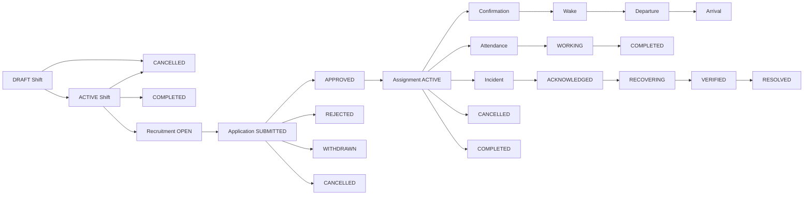
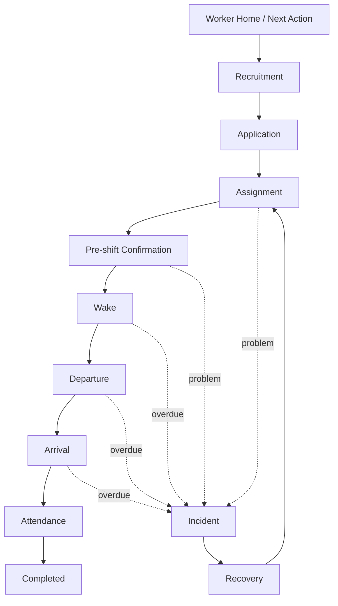
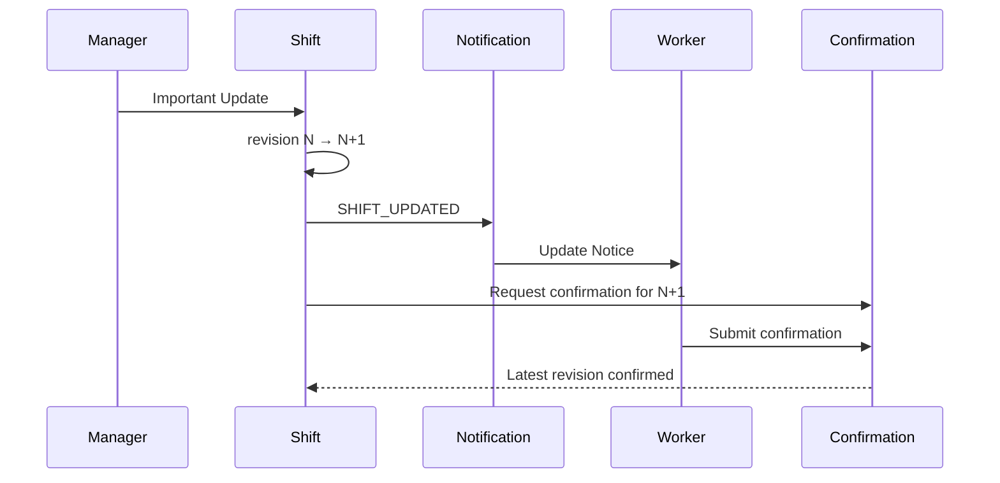
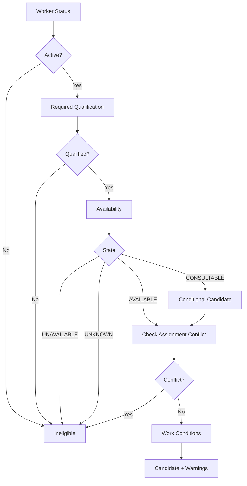
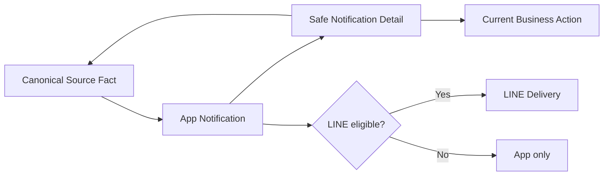
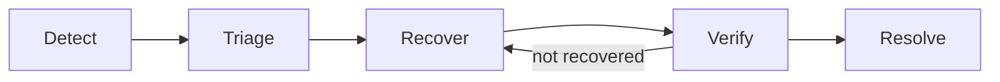

# OpsCue 統合仕様書 v1.3

**Product & Engineering Master Specification / 2026-10-23 現況反映版**  
**製品メッセージ：** 募集から、現場が無事に終わるまで。  
**設計原則：** One Shift, One Timeline.  
**文書状態：** 統合マスター（設計判断と報告ベースの現況を区別）  
**対象リポジトリ：** `kazenomikezaburo/OpsCue-app`（現行共同開発対象）  
**担当：** PM/Owner、Frontend katou、Backend wwakanarai  
**短期目標：** 2026-10-29 デモ判定、10-30 機能凍結、10-31 技育展予選、11-28 本選（進出時）

> **注意：** この文書は実装・マージ・push・本番DB変更・AWS操作・公開の実行承認ではない。最新のGitHub、DB、AWS、Figmaを独立監査した結果でもない。記載するPASS件数・実装進捗は担当者の報告に基づく。実行操作は対象、環境、変更範囲、検証方法を定めて別途PM承認する。

## 0. v1.3の位置づけと読み方

本版は **v1.2（2026-10-10）を削除せず全文保全** し、2026-10-23までのUI/UX統合、Shared Contracts、担当別開発手順、BackendのP0修正・API/DTO検討を「現行追補」として前置する。旧記述を無言で置換しない。矛盾点は差分台帳に明示し、合意が必要なものは未確定のまま管理する。

**仕様状態ラベル：**

| ラベル | 意味 |
|---|---|
| `BASELINE` | v1.2以前の採用済みプロダクト契約。後続決定がある箇所は変更履歴と併読 |
| `PM_DECIDED` | PMが方針決定済み。ただしDB/API/UI実装・反映は未保証 |
| `UI_SPEC` | UI/UX文書上の合意。稼働中の実装を保証しない |
| `REPORTED` | 担当者報告・テスト報告。独立検証前 |
| `PROPOSED` | 提案・RC・将来計画。実装承認ではない |
| `VERIFY` | 現行コード・DB・API・仕様の照合が必要 |
| `BLOCKED` | 承認・安全条件・検証不足により進めない |

**文書の使い分け：** 本書が製品横断の意思決定・責任境界の入口。`OpsCue_UIUX_完全版統合仕様書_v1.0.md` は画面・操作詳細、`OpsCue_Shared_Contracts.md` は役割間の業務契約、API/DTO v1.0-RC・PR設計はインターフェース候補と実装検証の根拠、担当別手順書は作業・承認ゲート。矛盾時は安全性を弱めず、現行実装の事実を調査してPMが決定する。文書名の新しさだけでDB/RLSの正当性を判断しない。

## 1. v1.2 → v1.3 更新要約

| 領域 | 更新点 | 状態 |
|---|---|---|
| UI | Worker・Admin・Shared Contractsの3文書をUI/UX統合仕様として整理 | `UI_SPEC`、実装照合前 |
| Worker募集 | 案件単位の一覧・詳細・一括応募モック、PR-UI-01の14ファイルとPhase 2 | `REPORTED`、範囲限定 |
| Admin認可 | PR-02でinactive Managerと支店アクセスを是正する計画・ローカル実装報告 | `REPORTED` |
| 配置 | PR-03で旧配置RPCの迂回を閉鎖し、候補配置経路を統一 | `REPORTED` |
| 応募審査 | PR-05の審査RPC、直接UPDATE制限、警告確認、冪等性 | `REPORTED` + 追加`VERIFY` |
| 勤務可否 | W1 + R1 + A2 + K1をPM採用。UNKNOWN等の条件付き配置方針 | `PM_DECIDED`、11月実装候補 |
| 一括応募 | 同一案件1〜10シフト、全件成功または新規0件、batchKeyによる再照会 | `PROPOSED` / v1.0-RC照合 |
| 開発・公開 | 10/31はUI専用の合成デモ優先、11月に安全な統合 | `PM_DECIDED` |
| AWS | PM管理の安全設計・費用・IAM、公開基盤は別ゲート | `VERIFY` / 未公開 |

## 2. プロダクト・情報設計の正本

OpsCueはSTAFF EXPRESS/NEO等の給与・契約・基幹業務を置き換えず、募集→応募→審査→配置→前日確認→出発・到着→勤怠→ヘルプ/復旧→完了を扱う現場オペレーション基盤である。Workerには「次にすべきこと」、Adminには「対応が必要な現場・人」を提示する。

```text
取引先（Client）
└─ 案件（Project）
   └─ 業務（Job）
      └─ シフト（Shift）
         ├─ 募集（Recruitment）→ 応募（Application）→ 審査
         ├─ 配置確定（Assignment）→ 配置計画（Placement）
         ├─ 前日確認 / 起床 / 出発 / 到着
         ├─ 勤怠 / Attention / Incident / Recovery
         └─ Notification / Audit

勤務先マスタ → 業務・シフトの勤務先スナップショット
Worker → 勤務可能時間 / 希望条件 / スキル・資格 / 変更申請
```

**不変の区別：** 応募承認≠Assignment作成、Assignment≠Placement、到着≠勤怠開始、通知既読≠業務完了、勤務希望≠勤務可否、AI推定≠Canonical Fact。「シフト運用」は横断管理画面でありデータの親ではない。履歴は監査可能に保持する。

## 3. UI/UXの現行契約

### 3.1 Worker

- **モバイルファースト：** 64pxヘッダー、74px下部ナビ、5タブ「ホーム／募集／勤務／サポート／マイページ」。デスクトップは240pxサイドバー・72pxヘッダーを基準とする（`UI_SPEC`）。
- **ホーム：** Canonical Factsに基づく「今日やること」（actionable/overdue）、次の勤務、募集中の仕事（最大2件）。未読通知だけをタスクの正本にしない。
- **募集：** 案件ID `projects.id` でグループ化し、一覧→案件詳細→シフト選択→確認→結果。選択理由と警告を分離。UIデモは合成fixtureで実応募しない。
- **勤務：** 自分のAssignment、勤務詳細、前日確認、起床・出発・到着、勤怠、ヘルプ。重要変更時は最新Shift revisionを再確認する。
- **サポート：** 通知、お知らせ、関連勤務のヘルプ/SOS。実装されていない機能を動作可能と誤認させない。
- **マイページ：** 勤務可能時間、希望条件、LINE連携、通知設定、プロフィール・申請。権限と保存先は個別契約に従う。
- **通知：** ヘッダーのベルからタブ外の一覧・詳細へ。通知の既読と業務状態は独立。

### 3.2 Admin

- **PC中心：** ホーム、要対応、案件・シフト運用、配置、勤怠、スタッフ、ヘルプリクエスト、お知らせ、取引先・勤務先・資格等の管理画面。詳細なメニュー・表示条件はAdmin UI仕様を参照。
- **ホーム：** 今日のサマリーと例外優先の要対応を分離し、現場・スタッフの状況にドリルダウンできる。
- **案件：** 案件→業務→シフトの親子関係、案件詳細からシフトや履歴へ。募集・審査・配置の更新は権限付きサーバー操作。
- **審査：** 応募状態と警告を確認し、RPCで承認/却下。承認と配置は別段階。
- **配置：** 有効なAssignment、資格、重複、勤務可否、支店権限、定員をサーバー側で再検証。Candidate Pickerの結果は認可証明ではない。
- **スタッフ・勤怠・申請：** スタッフ情報の閲覧範囲を支店等で制限し、修正・承認は理由と監査記録を伴う。
- **お知らせ・SOS：** 公開対象、対応状態、担当、履歴、通知の責任を分離する。

### 3.3 共通の画面状態と受入基準

全主要画面でloading / empty / error / permission denied / stale / successを区別する。破壊的操作や二重送信には確認と再取得を設け、エラー時に成功表示をしない。スマホ幅で横スクロール・タップ領域・固定ナビとの重なりを確認する。テスト用・合成データにはデモ表記を付け、実データや本番稼働と誤認させない。

## 4. 募集・一括応募の共通契約

| 項目 | v1.3での扱い | 状態 |
|---|---|---|
| 案件の識別 | `projects.id`。案件名によるグループ化禁止 | `PROPOSED`（RC） |
| 日付 | Asia/Tokyoのシフト勤務開始日。日時はoffset付きISO 8601 | `PROPOSED`（RC） |
| 選択 | 同一案件の一意な1〜10シフト | `PROPOSED`（RC） |
| 原子性 | 一括応募は全件処理か新規応募0件。単一RPCの連続呼出しで代用しない | `PROPOSED`（RC） |
| 警告 | `OVERLAPS_OWN_PENDING_APPLICATION`、`AVAILABILITY_NOT_CONFIRMED`などは非ブロック | `PM_DECIDED`/要照合 |
| ブロック | 取下げ後・却下後の再応募不可、募集終了、定員、資格不足、明示不可、Assignment重複等 | `VERIFY` |
| unknown結果 | 通信断等では成否を断定せず、同じbatchKeyで照会・回復 | `PROPOSED`（RC） |
| 冪等性 | `(Worker,batchKey)`、正規化要求の同一性、異要求の競合 | `PROPOSED`（RC） |
| 可視性 | 権限外案件・他Workerの情報や存在を漏らさない | `BASELINE` |

**一括応募の状態契約：** UI側の表示状態 `success / failure / validation_error / unavailable / unknown` と、Backend候補の `resolved / validation_error / unavailable / idempotency_conflict / unknown` は同一の列挙値ではない。DTO adapter・エラー変換表を合意してから接続する。`unknown`中は新規キーで安易に再送しない。

**再応募：** 既存DB制約と静的調査に基づく取下げ・却下後の再応募禁止方針を維持。`WITHDRAWN_REAPPLY_NOT_ALLOWED` と `PREVIOUS_APPLICATION_REJECTED` の区別をUI/Backendで照合する。DBが実際にどの状態を返すかは独立検証が必要。

## 5. PR-02 / PR-03 / PR-05：認可・審査・配置

### 5.1 PR-02（Managerの支店アクセス）

inactive Managerや支店権限のない主体が、直接DML・RPC・一覧・詳細から権限外データを参照/変更できないこと。`private.has_branch_access` とRLS、Managerのactive状態、role、branchを整合させる。`REPORTED`：ローカル修正・検証が進んでいるとの担当者報告。main統合・実DB適用は別途確認。

### 5.2 PR-03（Assignment作成）

配置経路を検証済みの候補RPCへ統一し、旧 `create_assignment_from_application` の不要なEXECUTE権限を閉じる。Worker active、支店、資格、勤務可否、時間重複、シフト状態、定員、lock順序、旧UI/統合テストの回帰を確認する。旧経路が残る状態で「新経路が安全」と断定しない。

### 5.3 PR-05（審査RPC）

`review_shift_application` を候補とし、Adminの直接UPDATEを安全な審査コマンドに置換する。shift→Worker→application→receiptの共通lock順序、active Manager・branchアクセスの検証、冪等性を維持する。`withdrawn→applied`、`rejected→accepted`等の不正遷移を拒否する。cancelled/completed shift、inactive Workerへの承認は禁止。警告がある承認は二段階確認とし、初回は状態変更しない。

**追加PM条件：** 確認前後で警告集合が変化したら、同じキーの無条件acknowledgeで承認してはならない。警告集合の識別子等を照合して再確認させる。不要な直接INSERT/UPDATE権限をrevokeする際、既存の正当なRPCやテストを壊さないこと。通知の実装はP1に繰延可能。`REPORTED`：PR-05のローカルテスト34/34 PASS。警告変化時の再確認・追加revoke・main統合は**未検証**。

## 6. 勤務可否 P0-4：v1.2 §14.2からの変更決定

**PM決定：** `W1 + R1 + A2 + K1` を採用し、11月実装候補とする。DB内部の5分類（`explicitly_available` / `consultation_required` / `partially_available` / `unknown` / `explicitly_unavailable`）と旧UIの4分類（AVAILABLE / CONSULTABLE / UNAVAILABLE / UNKNOWN）は一対一対応ではない。部分可は全時間帯の勤務可とみなさず、対象シフト全体について確認が必要な状態として扱う。

| 段階 | ルール | 状態 |
|---|---|---|
| W1 Worker応募 | 不明・相談・部分可は警告 `AVAILABILITY_NOT_CONFIRMED` を表示して応募を許容 | `PM_DECIDED` |
| R1 Admin審査 | 同警告の明示確認を条件に承認を許容 | `PM_DECIDED` |
| A2 Admin配置 | 不明・相談・部分可は明示的な本人確認等の証跡を要求して配置を許容 | `PM_DECIDED` |
| K1 証跡 | 誰が、いつ、どの勤務可否を、どの確認方法で扱ったかreceipt/Auditに残す | `PM_DECIDED` |
| 明示不可 | `explicitly_unavailable` は通常の応募・配置を拒否。例外化は別途決定 | `BASELINE` |
| Assignment時間重複 | 勤務可否とは独立したhard block | `BASELINE` |

**重要な変更点：** v1.2 §14.2の「UNKNOWNは通常Assignment hard block」と、v1.3のA2は一致しない。ここは**v1.3のPM方針をターゲット仕様**として扱うが、DB/RPC・既存UIが自動的に変更されたことにはならない。実装前にShared Contracts、API/DTO、テストケース、監査項目を一括更新する。

## 7. Shift変更・勤務・通知・監査

- **Shift revision：** 重要変更は`expected_revision`による競合検知、変更理由、監査、通知、最新revisionへの再確認。古い確認記録を削除しない。
- **Assignment取消：** Workerは確定配置を直接削除せず取消申請を行い、Adminが審査。No Showと取消は別事象。
- **Journey：** 起床・出発・到着はWorker本人の独立Action。Manager代理操作を本人の操作と偽装しない。
- **Attendance：** 到着を自動で勤務開始とせず、開始・終了・欠勤・修正を独立管理。正式勤怠の正本は初期段階で既存基幹と責任分界する。
- **Attention / Incident：** 業務事実から例外を導出し、検知→対応→復旧→検証→解決まで追跡する。
- **Notification：** アプリ内通知を正本、LINEを同意と配信条件を満たす補助手段とする。READ≠RESOLVED。通知の未読数から業務の完了/未完了を推定しない。
- **Audit / Retention / DR：** actor、対象、before/after、理由、時刻、相関ID、権限境界を必要に応じ記録。保持・削除・バックアップ復元は旧マスターの安全条件を維持し、実証前にProduction Readyとしない。

## 8. アーキテクチャと公開・セキュリティゲート

- **Frontend：** Next.js / TypeScript / Tailwind / shadcn/ui等。Workerはmobile first、Adminはdesktop first。UI-only fixtureと実DB接続を明確に分離。
- **Backend：** Supabase Postgres / Auth / RLS / SQL RPC / server-side validationを中心とした構成。実際のschema・権限・migration適用状況は現物照合が必要。
- **AWS：** PM担当のIAM/MFA/費用管理/ネットワーク/監視/実行基盤を段階設計。現時点で本番稼働済みと表現しない。LINE、cron、scheduler、dispatcher、Secrets、バックアップ復旧も別の安全ゲート。
- **環境分離：** `dispatch-os-dev`等の保全対象には承認なしで接続しない。テストは合成データ専用の隔離環境で、対象URL・branch・migration・操作を明示する。
- **PR/DB：** ローカルテストPASSとmainマージ、クラウドmigration、本番公開はそれぞれ別判定。最小権限、revoke後の回帰、RLSの否定系、並行性、ロール変更時の再検証を必須とする。
- **秘密情報：** publishable keyのような公開前提の値とservice role等の秘密を区別。秘密はリポジトリ・スクリーンショット・報告書へ記載しない。

## 9. 2026-10-23時点の開発・検証状況

| トラック | 担当 | 現況 | 次の受入ゲート |
|---|---|---|---|
| PR-UI-01 Phase 1 | Frontend | 14ファイルのローカルコミット報告 | 変更範囲・UI確認・fixtureの契約照合 |
| PR-UI-01 Phase 2 | Frontend | `recruitment-demo.tsx`とfixtureの2ファイルに条件付き作業範囲 | Props/callback、合成表示、型チェック・プレビューは別承認確認 |
| PR-02 | Backend | 支店権限修正・ローカル検証の報告 | inactive Manager・他支店・直接DML否定系 |
| PR-03 | Backend | 配置RPC修正・ローカル検証の報告 | 旧RPCのEXECUTE閉鎖・UI呼び出し元・競合 |
| PR-05 | Backend | 不正遷移6/6再現、修正後34/34 PASSの報告 | 警告集合変化、INSERT/UPDATE権限、回帰 |
| P0-4 | Backend / PM | 方針決定、11月候補 | 5状態→UI/DB/DTOの対応表と確認証跡 |
| P0-5 一括応募 | Backend / Frontend | v1.0-RC、UIモックとDTO照合段階 | エラー変換、receipt、並行性、unknown回復 |
| AWS / 公開 | PM | 設計・準備。実公開・本番適用は別ゲート | 費用、IAM、Secrets、監視、復旧、Go/No-Go |

**注意：** PR番号は作業トラック名として使用しており、GitHubにPRが存在する、merge済み、またはクラウドDBに適用済みという主張ではない。固定SHA、migration ID、テストログ、変更ファイル一覧を証拠として記録する。

## 10. 10/23〜11/28 工程・受入

| 期間 | PM / Owner | Frontend | Backend | 成果物 |
|---|---|---|---|---|
| 10/23〜24 | 仕様差分・承認範囲整理 | 募集UIモック接続 | PR-02/03/05証拠整理 | 変更一覧・デモ導線 |
| 10/24〜26 | API/DTO差分判断 | fixture/型の照合 | UI画面テスト（承認範囲内） | 差分表・PASS/FAIL |
| 10/27〜28 | 発表資料・操作台本 | デモ表示修正 | 安全性・停止条件確認 | 動作動画・代替手順 |
| **10/29** | **Go/No-Go判定** | UIデモ受入 | 実DBを使う場合の安全証拠 | デモ方式決定 |
| **10/30** | 機能凍結・リハーサル | 重大不具合のみ | 重大不具合のみ | 発表準備完了 |
| **10/31** | **技育展予選** | UIデモ支援 | 技術説明支援 | 発表・デモ |
| 11/01〜11/28 | 予選結果に応じて再計画、AWS/公開判断 | Worker/Admin接続・QA | P0-4/P0-5、RPC/DB統合・QA | 本選向け完成度向上 |

**デモ方針：** 10/31は安全に再現できる**合成fixtureのUI専用デモ**を第一候補とする。Backend連携を示す場合は、対象環境、データ、権限、テスト証拠を揃え、PMが明示Goを出した範囲のみ。未検証の機能を実動作として発表しない。11/2の公開ベータは必須目標ではない。11/28は予選通過時の目標であり、落選時は期限を緩和して開発継続可能。

## 11. PM承認と変更管理

**個別承認が必要な操作：** Git branch/checkout/fetch/commit/push/PR、コード・migration変更、SQL・Supabase CLI・Docker・テスト実行、AWS/LINE/cron/公開等。過去の個別承認がある場合はその対象・期間・環境・ファイル範囲だけを適用し、一般許可へ拡張しない。承認条件が衝突するときは狭い方を採用し、PMに確認する。

**変更提案の最小記録：** 変更ID、現行仕様、提案仕様、理由、対象ロール/画面/API/DB、後方互換、migration/rollback、セキュリティ影響、テスト、担当、PM判断、実装状態、検証証拠。文書修正のみで製品変更が承認されたとみなさない。

**停止条件：** 予期しない秘密情報・実個人情報、接続先不明、承認外の変更、他人の作業との衝突、RLSの抜け道、危険なmigration、環境差異、データ破壊の可能性。停止・保全・報告し、強制pushやDB resetで独断修復しない。

## 12. 未解決事項と差分台帳（v1.3）

| ID | 論点 | 必要な判断・検証 | 優先 |
|---|---|---|---|
| M-01 | v1.2 UNKNOWN hard blockとP0-4 A2の不一致 | 仕様変更記録、DB/DTO/RPC/監査テストの更新 | P0/11月 |
| M-02 | DB5分類と旧UI4分類 | `partially_available`の表示・確認方法・境界時刻 | P0 |
| M-03 | PR-05警告変更時の再確認 | warning fingerprint、同一キー再確認、race test | P0 |
| M-04 | PR-05直接権限の閉鎖 | UPDATE/INSERT/EXECUTEと既存RPCの回帰 | P0 |
| M-05 | PR-03旧RPC閉鎖 | UI/テストの呼び出し元、revoke、並行配置 | P0 |
| M-06 | 一括応募のDTO差異 | UI結果kind↔Backend kind、理由コード、nullable | P0 |
| M-07 | 一括応募receipt | 同時リクエスト、unknown回復、保持期間、key管理 | P0 |
| M-08 | UI完全版と現行コード | 各画面の実装・未実装・モック区別 | P0 |
| M-09 | PR-02/03/05の現行main反映 | commit SHA、migration ID、テスト証拠 | P0 |
| M-10 | AWS/LINE/本番運用 | IAM、Secrets、監視、予算、DR、公開承認 | P1 |
| M-11 | Worker申請とAdmin審査 | 権限、状態遷移、通知、監査の実DB照合 | P1 |
| M-12 | 勤務先スナップショット | マスタ変更時の履歴不変・表示更新ルール | P1 |
| M-13 | 過去のSHARE-28/541件staging | 旧プロジェクトの歴史的HOLDと現行repoの関係を再棚卸し | P2 |

## 13. 参照資料と改訂履歴

| 資料 | 本版での用途 |
|---|---|
| `OpsCue 統合仕様書 v1.2`（2026-10-10） | 全文保全する歴史的ベースライン |
| `OpsCue_UIUX_完全版統合仕様書_v1.0.md` | Worker/Admin/SharedのUI/UX詳細 |
| `OpsCue_Shared_Contracts.md`（v0.1 Draft） | 横断業務契約・PM判断・未解決事項 |
| `OpsCue_Frontend_開発手順書_20261023_改訂版.md` | Frontendの作業範囲・ゲート |
| `OpsCue_Backend_開発手順書_20261023_改訂版.md` | BackendのP0・テスト・ゲート |
| `OpsCue_PM_Owner_開発管理手順書_20261023_改訂版.md` | PM/Ownerの工程・承認・公開判断 |
| `PR05_審査RPC_設計.md`、`P0-4_勤務可否の扱い_選択肢.md` | 審査と勤務可否の判断根拠 |

**v1.3 / 2026-10-23：** 2026-10-23までのUI/UX、PR-02/03/05、P0-4、P0-5、担当別工程、10/31 UIデモ方針を追補。v1.2原文は以下に変更なしで保存。外部システムの更新なし。

---

# 付録A：OpsCue 統合仕様書 v1.2（2026-10-10）全文保存

> **歴史的ベースライン：** 以下はv1.2の原文。本文中の「現時点」「未承認」「完了済み」等は原文当時のスナップショット。2026-10-23の現況には上記v1.3追補を優先して参照し、実装上の矛盾は差分台帳へ登録する。

# OpsCue 統合仕様書 v1.2

**2026年10月10日 現況追補版 / Product & Engineering Master Specification**

> 募集から、現場が無事に終わるまで。  
> One Shift, One Timeline.

**文書状態:** 仕様ベースライン + 2026年10月10日時点の報告ベースの追補  
**前版:** v1.1 / 2026年10月1日  
**対象:** プロダクト、UI/UX、バックエンド、セキュリティ、QA、共同開発、技育展応募  
**重要:** 本追補はリポジトリ・DB・AWS・Figmaの最新状態を直接監査したものではない。2026年10月10日までのユーザー提供画像・作業報告を反映した編集版である。

---

# v1.2 更新サマリー

## 1. 更新方針

- v1.1の技術仕様・権限境界・状態モデル・運用設計を削除せず、後半に「v1.1原文」を全文収録する。
- 10月10日までの進捗は、元の「30. 現在地」を直接書き換えるのではなく、この追補の最新ステータスを優先して参照する。
- 仕様、ローカル実装、検証、Figma案、作品紹介用イメージ、本番稼働を混同しない。
- 本書の記述は公開・共同開発・本番運用の承認を与えない。保留条件は維持する。

## 2. 更新履歴

| 項目 | v1.2での扱い |
|---|---|
| Product message | 「募集から、現場が無事に終わるまで。」を維持 |
| Admin UI | 最新の管理者ホーム画面の共有内容を反映 |
| Worker UI | 最新のスタッフホーム画面の共有内容を反映 |
| 作品紹介 | 技育展2026応募用のビジュアルを資料上の表現として追加 |
| 開発・共同作業 | staging 541件、SHARE-28、保留条件を明示 |
| セキュリティ | 本番・LINE・共有の未承認状態を維持 |
| v1.1本文 | 2026-10-01時点の歴史的ベースラインとして全文保存 |

## 3. 用語と優先順位

- **Product Contract:** v1.1に記載された確定仕様。v1.2で明示変更した箇所だけを更新対象とする。
- **Reported Local Evidence:** ユーザー提供の画面や作業報告。監査済み本番実績ではない。
- **Visual Concept:** 作品紹介用の理想画面・合成ビジュアル。動作画面や機能実装の証明ではない。
- **HOLD:** 技術・セキュリティ上の未解決条件。期限が近くても自動解除しない。

---

# A. プロダクトと現場課題の再定義

## A.1 開発のきっかけ

発案者自身が派遣スタッフとして勤務する中で、案件情報、集合時刻、注意事項、勤務前後の連絡が複数の媒体に散らばる不便さを経験した。派遣会社の管理側との雑談でも、前日や当日朝の連絡をより分かりやすくする仕組みが欲しいという相談を受けている。また、同じ現場で働くスタッフからも使いづらさを聞いており、管理者とスタッフ双方の課題として認識している。

これは特定企業の正式な導入依頼や採用決定を意味しない。現場経験と会話を起点にした課題仮説として扱う。

## A.2 現状の情報分散

| 媒体・システム | 実際に扱われる情報の例 | 現場での課題 |
|---|---|---|
| LINE / グループLINE | 募集、集合案内、前日確認、出発・到着連絡、質問 | 長文・履歴から必要情報を探す。グループの有無が現場によって異なる |
| 紙 | 休憩回し、配置、注意事項、業務内容 | 現場に行かないと確認できない情報がある |
| Googleスプレッドシート | 配置、人数、時間帯、会場別手配 | 現場別の表を横断して確認する必要がある |
| Googleフォーム | 現場によっては始業・終業の報告 | 報告の入口や手順が勤務先ごとに異なる |
| STAFF EXPRESS / NEO | 契約、シフト、勤怠、給与・支給照会等 | 基幹業務は存在するが当日の運用連絡は別媒体に残りやすい |
| Tayori / Drive / PDF | 案件情報、FAQ、連絡先、手順書 | 勤務と関連資料の参照先が分かれる |
| 電話 | グループLINEのない現場等での個別連絡 | 担当者への連絡が集中し、履歴の共有が難しい |

## A.3 OpsCueが解決する範囲

OpsCueは給与・契約の基幹システムを置き換えない。募集、応募、配置、前日確認、出発・到着、当日運用、ヘルプ・SOS、勤務完了までの現場オペレーションを、一つのShiftを軸に見渡せるようにする。

- Worker: **今やること、次の勤務、必要な勤務詳細**を迷わず確認する。
- Admin: **今対応が必要なスタッフ・現場・異常**を優先して確認する。
- 組織: 対応履歴、権限、変更、通知、復旧を説明可能な状態として扱う。

---

# B. 最新UI・情報設計（共有画面に基づく）

## B.1 Admin Home

2026年10月に共有された最新版の管理者画面では、次の構成を確認した。

1. 左サイドバー: ホーム、要対応、案件、シフト運用、勤怠、スタッフ、ヘルプリクエスト、お知らせ、取引先、スキル・資格、設定（準備中）。
2. 要対応: 優先度の高い項目を表示する領域。共有画面では0件の空状態を表示。
3. 今日のサマリー: 本日の稼働、正常稼働、要確認、SOSの4指標。
4. 今日の現場: 配置状況と対応状況の一覧への導線。共有画面では勤務予定なしの空状態。

画面はテストアカウント・テストデータを含むローカルUIの提示であり、実際の運用件数や本番利用を示すものではない。

## B.2 Worker Home

共有された最新版のスタッフ画面は、モバイルを主軸に以下を表示する。

1. 今日やること: Canonical Factsから導出するAction。対応がなければその旨を表示。
2. 次の勤務: 日時、勤務先、確認状態、勤務詳細へのリンク。
3. 募集中の仕事: 一覧への導線とプレビュー。
4. 下部5タブ: ホーム、募集、勤務、サポート、マイページ。
5. 通知入口: ヘッダーのベル。

テストデータに古い日付、英語の仮名称、募集ステータスの表示などが含まれるため、デモ・発表前に表示内容の整合性を見直す。

## B.3 UIの改善方針

- Adminの「要対応」と「今日のサマリー」は役割を分け、同じ数字の繰り返しを避ける。
- Workerは勤務詳細への導線を主CTAとして扱い、緊急Actionがない場合に過剰な通知を出さない。
- 日時・ステータス・データの出所を統一し、テストデータと本番相当のデモデータを明確に分ける。
- 「画面に表示できること」と「サーバー側で安全に処理できること」は別に検証する。
- FigmaはVisual/IAの参照とし、認可・DBの正本にしない（v1.1の優先順位を維持）。

## B.4 作品紹介ビジュアルの扱い

技育展2026向けの紹介画像では、左にOpsCueのメッセージ、右にPCのAdmin UIとスマホのWorker UI、下部に「募集 → 応募 → 前日確認 → 出発 → 到着 → 勤務 → 完了」の流れを示す。これはプロダクトコンセプトを伝える**表現用の合成ビジュアル**であり、実際の稼働画面・本番データの証拠ではない。

---

# C. 実装・検証・共有の現況（報告ベース）

## C.1 ローカル実装

v1.1の第30章に列挙されたAdmin/Worker業務、Recruitment、Assignment、Confirmation、Journey、Attendance、Notification、LINE Local、AWS CDK準備等は、**2026年10月1日時点の自己申告ベースライン**として残す。10月10日までに共有された最新版UIはB章の通り。各機能の現行実装とテスト証拠を完全再照合したわけではないため、機能別のProduction Ready判定はしない。

## C.2 共同開発用staging

| 項目 | 2026-10-10までの報告内容 |
|---|---|
| 原本ファイル数 | 4,973件 |
| 共有候補 | 541件（Web中心のstaging候補） |
| 旧候補スキャン | 564件を対象とした過去のオフライン検査では検出報告なし |
| 最終候補541件の検査 | 未完了。旧564件の結果を流用しない |
| 原本保護対象159件 | 独立した一覧が復元されておらず、単独照合は未実施 |
| Git | index / config / HEAD / branchの一致を再確認したとの報告 |
| 共有・Push・招待 | 未承認。実施しない |

stagingの候補は安全な共有物として承認されたものではない。過去に公開されたGit履歴も、クリーンな共同開発用リポジトリへそのまま持ち込まない。

## C.3 SHARE-28 / Native Job Supervisor

- `ProcessJobSupervisor.cs` と静的レビュー報告書を再確認したとの報告。
- C#ソースのSHA256は報告値と一致。
- 既存143項目PASSは過去の検証結果であり、新しいC#実行検証ではない。
- Directory接続、I/O停止・完全回収は未完了。
- DLL生成・ロード、Native呼出し、Job生成、最終541件の実Scanは未実施。
- SHARE-28はSTOP / HOLD。安全性・共有許可の成立を意味しない。

## C.4 Historical / Production Gates

- Historical Event C / D: NOT_AUTHORIZED。
- LINE本番送信・実Provider検証: 完了したとは扱わない。
- 通常Dispatcher・Scheduler: DISABLEDの設計条件を維持。
- AWS本番デプロイ、Supabase本番、実運用E2E、バックアップ復元: 未完了・要検証。
- 本番化にはv1.1の第29章「Production Readiness Gate」を別途満たす必要がある。

## C.5 次に必要な承認・確認

1. 共同開発の共有前に、最終541件の実スキャン、ファイル単位の権利・機密・秘密情報確認、原本保全確認を完了する。
2. Native Supervisorの未検証部分を実行可能な環境で安全に検証する。未完了なら別の承認済み安全手順を設計する。
3. クリーンなPrivateリポジトリの作成、コミット、招待は各操作の明示承認後に行う。
4. 本番AWS、LINE、DB、監視、DRは製品の公開承認と分けて検証する。

---

# D. 共同開発・技育展2026向け運用

## D.1 3人チームの分担案

| Role | 主な責務 |
|---|---|
| PM / Tech Lead / Full Stack | 要件、優先順位、仕様整合性、セキュリティGate、応募提出、統合レビュー |
| Frontend Lead | Admin/Worker UI、Figmaとの整合、レスポンシブ、操作性、画面デモ |
| Backend Lead | DB、Server Actions/RPC、RLS、状態遷移、Audit、検証 |

役割は提案であり、チーム合意によって変更可能。

## D.2 応募資料と製品仕様の区別

- 作品紹介画像: プロダクトの世界観とユースケースを伝える。
- 応募PDF: 課題、価値、実装済みの範囲、技術、今後の計画を説明する。
- 統合仕様書（本書）: 実装・認可・状態・運用の詳細基準。
- 公開リポジトリや実演URL: 安全確認が済むまで必須資料として扱わない。

## D.3 短期優先順位

応募期限が近い期間は、応募用資料とデモの正確性を優先する。ただし、SHARE-28や本番Gateを締切を理由に解除しない。デモでは合成画像と実動作画面を明確に区別し、テストデータに個人情報・秘密情報を含めない。

---

# E. v1.2 Decision Register

1. **原仕様維持:** v1.1の認可、Canonical Facts、通知、LINE、Audit、Retention、DR、DoDの契約を維持。
2. **UI更新:** 最新のAdmin/Worker Home共有画面をB章に記録。Figmaと実装の差異は未解消のまま明示。
3. **現況更新:** 第30章の旧ステータスは10月1日時点のスナップショット。現況はC章を優先。
4. **共有Gate維持:** SHARE-28はSTOP、541件の最終検査未了、共有未承認。
5. **紹介画像:** 合成ビジュアルを動作証拠として扱わない。
6. **確認待ち:** 実装の最新差分、DB schema、UIの完成度、監視・本番証拠は今後の照合対象。

---

# v1.1 原文ベースライン（2026年10月1日）

以下は元のv1.1を全文収録した歴史的仕様ベースラインである。本文中の「現在地」「完了済み」「未実装」等は**2026年10月1日時点の記述**であり、2026年10月10日時点の確認結果ではない。更新分は前掲A〜E章を参照する。

---

# OpsCue 統合仕様書・Master Specification

**版:** 1.1  
**基準日:** 2026年10月1日  
**状態:** Master / Product & Engineering Baseline  
**対象:** OpsCue 企画、現行ローカル実装、Figma設計、Worker UI-W1完了時点、LINE C1/C2、本番準備、2026年10月1日までの仕様決定  
**用途:** 企画説明、UI設計、Codex実装、レビュー、QA、本番準備、運用設計の共通基準

> **OpsCueの仕様上の基準文書。**
>
> 実装済み、ローカル検証済み、UI改修中、計画、将来構想、本番未検証を明確に区別する。  
> 不明点を推測して実装せず、安全に確定できない場合はBLOCKEDとして停止する。

---

# 0. 文書管理

## 0.1 統合元

本書は次の資料・決定を統合したものである。

- `OpsCue 企画書.md`
- `OpsCue_総合仕様書_2026-09-30(1).md`
- `OpsCue 派遣会社向け 完成イメージ仕様書`
- Figma `04 Worker｜Refined v1`
- Worker UI-W1 実装結果
- 2026年10月1日に確定した以下の追加仕様
  1. 権限マトリクス
  2. 状態遷移
  3. Shift変更・取消
  4. Availability / Schedule Submission
  5. Notification
  6. Audit Log / Data Retention
  7. Backup / Disaster Recovery
  8. Definition of Done

## 0.2 名称

過去資料に残る `ShiftOps` 表記は、現行プロダクト名 **OpsCue** に統一する。

## 0.3 仕様状態

| 状態 | 意味 |
|---|---|
| **実装済み** | 現行ローカル実装に存在する |
| **ローカル検証済み** | 自動・手動テスト済み。本番完了を意味しない |
| **UI改修中** | 業務契約を維持してUI/IAを変更中 |
| **確定仕様 / 未実装** | Product仕様として決定済みだが未実装 |
| **計画** | 方針はあるが詳細・実装が未確定 |
| **将来構想** | MVP後に検討 |
| **要確認** | 現時点で証拠が足りず確定不可 |

## 0.4 規範語

本書では以下を使用する。

- **MUST**: 必須。満たさなければ仕様違反
- **MUST NOT**: 禁止
- **SHOULD**: 原則として実施。外す場合は理由を残す
- **MAY**: 任意

## 0.5 仕様の優先順位

競合がある場合は、次の順で扱う。

1. **認可・セキュリティ境界**  
   RLS、Server Action、private RPC、専用DB Role、署名検証などを弱めてはならない。
2. **本書の確定仕様**  
   Target Product Behaviorとして採用する。
3. **現行実装**  
   実装上の現実。Targetと異なる場合は差分として扱い、黙って仕様を曲げない。
4. **Figma**  
   UI/IA/Visualの基準。DB・認可・業務状態の根拠にはしない。
5. **過去資料・Archive/Future案**  
   本書に採用されていないものは自動的に現行要件としない。

## 0.6 変更管理

本書の変更では、少なくとも以下を記録する。

- version
- date
- changed section
- decision
- rationale
- implementation impact
- migration impact
- compatibility impact

---

# 1. プロダクト定義

## 1.1 サービス概要

**OpsCue** は、人材派遣会社・イベント運営会社等において、スタッフの募集、応募、配置、勤務準備、勤務前確認、当日の起床・出発・到着、トラブル対応、勤務完了までを一つの **Shift Timeline** として扱う現場オペレーションプラットフォームである。

OpsCueが管理したい中心課題は、

> **「誰が登録されているか」ではなく、今日の勤務が正常に成立しているか。**

である。

Workerには、

> **今、自分が何をすればよいか**

を提示する。

Adminには、

> **今、誰・どの現場に対応する必要があるか**

を提示する。

## 1.2 Product Message

> **募集から、現場が無事に終わるまで。**
>
> **One Shift, One Timeline.**

OpsCueは、募集から勤務完了までのOperational Factsを一つにつなぎ、WorkerにはNext Action、AdminにはAttentionとRecoveryを提示する。

## 1.3 想定利用

- Admin: PC中心
- Worker: Smartphone中心
- 管理者の一覧・比較画面: Desktop優先
- Worker当日操作: Mobile first

---

# 2. 背景と解決する課題

## 2.1 現状の分断

一回の勤務を成立させるために、複数のシステムや媒体を横断することがある。

| 領域 | 代表的な現行手段 | 内容 |
|---|---|---|
| 基幹 | STAFF EXPRESS | スタッフ、契約、給与、請求 |
| Worker Portal | STAFF EXPRESS NEO | 勤務予定、勤怠、支給照会、口座 |
| 募集・応募 | LINE | 案件案内、応募 |
| 勤務詳細 | LINE | 集合、時間、服装、持ち物 |
| 前日確認 | LINE | 起床予定、出発予定、体調、質問 |
| 当日確認 | LINE | 起床、出発、到着、遅刻 |
| 配置 | Spreadsheet / 紙 | メンバー、配置 |
| Manual | PDF / Drive / LINE | 業務手順 |
| Trouble | LINE / 電話 | 遅刻、欠勤、質問、緊急 |
| 現場 | 紙 / 口頭 | 配置、休憩、備品 |

問題は各ツールそのものではなく、

> **一つの勤務に必要な情報・Action・状態が複数の場所へ分断されていること**

である。

## 2.2 目指す変化

現在:

```text
人がLINE・表・紙を確認
↓
人が状態を頭の中で統合
↓
人が催促・判断・復旧
```

OpsCue:

```text
Operational Facts
↓
State / Readiness / Attention
↓
Next Action / Suggested Action
↓
Recovery
```

---

# 3. STAFF EXPRESS / NEOとの責任分界

OpsCueはSTAFF EXPRESSを置き換えることを目的としない。

## 3.1 STAFF EXPRESS / NEO

主として以下を扱う。

- スタッフの正式情報
- 契約
- 給与
- 請求
- 口座
- 正式な労務情報
- 初期段階における正式勤怠の最終正本

## 3.2 OpsCue

主として以下を扱う。

- Recruitment
- Application
- Assignment
- Placement
- Coverage
- Availability
- Schedule Submission
- Shift Detail
- Pre-shift Confirmation
- Wake / Departure / Arrival
- Operational Attendance
- Attention
- Incident
- Recovery
- Notification
- LINE Delivery History

> **STAFF EXPRESS = Back-office Core**  
> **OpsCue = Frontline Operations Platform**

## 3.3 System of Record

| データ | 正本 |
|---|---|
| スタッフ正式情報 | STAFF EXPRESS |
| 契約 | STAFF EXPRESS |
| 給与・請求 | STAFF EXPRESS |
| 口座 | STAFF EXPRESS |
| 正式勤怠 | 初期はSTAFF EXPRESS |
| Recruitment | OpsCue |
| Application | OpsCue |
| Assignment | OpsCue |
| Placement | OpsCue |
| Shift Operational State | OpsCue |
| Confirmation | OpsCue |
| Wake / Departure / Arrival | OpsCue |
| Operational Attendance | OpsCue |
| Attention | OpsCue |
| Incident / Recovery | OpsCue |
| App Notification | OpsCue |
| LINE Delivery History | OpsCue |

将来、正式勤怠等をAPI/CSV連携する場合も、System of Recordの責任を明示する。

---

# 4. Product Design Principles

## 4.1 One Shift, One Timeline

募集から勤務完了までを一つの勤務の流れとして扱う。

## 4.2 Exception-first Operations

正常な100件より、対応が必要な数件を優先表示する。

## 4.3 Closed-loop Recovery

異常を検出して終わらず、

```text
Detect
→ Triage
→ Recover
→ Verify
→ Resolve
```

まで扱う。

## 4.4 Explainable Staffing

Candidate Eligibilityは説明可能な根拠を表示する。

AIによる不透明な人物スコアをMVPの正本にしない。

## 4.5 Separate Facts

以下を混同しない。

- Application
- Assignment
- Placement
- Confirmation
- Journey
- Attendance
- Incident
- Attention
- Notification
- Availability
- Schedule Submission

## 4.6 Server-side Authorization

UIの可視性を認可の根拠にしない。

重要MutationはServer Action / RPC / RLS / Roleによって保護する。

## 4.7 Notification is Canonical, LINE is Delivery

アプリ内Notificationを通知の正本とする。

LINEは許可されたNotificationの外部配信手段。

## 4.8 AI is not a Canonical Fact

AI推論をQualification、Availability、Attendance等の正本へ直接変換しない。

---

# 5. 中核情報モデル

```text
Project
 └─ Job
     └─ Workplace association
         └─ Shift
             ├─ Recruitment
             ├─ Application
             ├─ Assignment
             ├─ Placement
             ├─ Coverage
             ├─ Pre-shift Confirmation
             ├─ Wake
             ├─ Departure
             ├─ Arrival
             ├─ Attendance
             ├─ Attention
             └─ Incident / Recovery
```

独立関連Entity:

- Client
- Worker
- Branch
- Workplace
- Skills / Qualifications
- Availability
- Work Conditions
- Schedule Request / Submission
- Announcement
- Notification
- LINE Account Link / Consent
- Notification Delivery / Attempt
- Audit Event

**要確認:** 全Table / Column / FK / Index / Constraintを含む正式ER図は実DB Schemaから抽出して確定する。

---

# 6. 状態モデル

## 6.1 共通ルール

- 巨大な単一State Machineを作らない。
- DomainごとにCanonical State / Factを持つ。
- Derived Stateを直接編集しない。
- Terminal Stateを原則巻き戻さない。
- 重要遷移はServer側でCurrent Stateを再確認する。
- 二重送信はIdempotentに扱う。
- Revision対象はOptimistic Concurrency Controlを行う。

## 6.2 Shift

Canonical State:

```text
DRAFT
  │
  ├────────→ CANCELLED
  │
  ↓
ACTIVE
  │
  ├────────→ CANCELLED
  │
  ↓
COMPLETED
```

- `CANCELLED` / `COMPLETED` はterminal。
- `RECRUITING / STAFFING / READY`をShift statusへ詰め込まない。
- Phaseは時間から算出する。

Derived Phase:

```text
UPCOMING
IN_PROGRESS
PAST
```

`starts_at / ends_at / now` から計算し、時間経過だけのためにDB状態を書き換えない。

## 6.3 Recruitment

```text
DRAFT
  │
  ├────────→ CANCELLED
  ↓
OPEN
  │
  ├────────→ CANCELLED
  ↓
CLOSED
```

- `CLOSED → OPEN` の再募集はMAY。
- 再募集はManager/System Adminのみ。
- 再開理由をAuditする。
- `CANCELLED`はterminal。
- `NORMAL / ADDITIONAL / EMERGENCY` はtypeでありstateではない。

## 6.4 Application

```text
              ┌→ APPROVED
SUBMITTED ────┼→ REJECTED
              ├→ WITHDRAWN
              └→ CANCELLED
```

意味:

- `WITHDRAWN`: Worker自身の応募辞退
- `REJECTED`: Admin審査結果
- `APPROVED`: 応募承認
- `CANCELLED`: Shift/Recruitment取消等、応募者・審査者の責任ではない終了

`APPROVED` とAssignment作成は別操作。

## 6.5 Assignment

```text
ACTIVE
  ├────────→ CANCELLED
  └────────→ COMPLETED
```

Pre-shift / Wake / Departure / ArrivalをAssignment statusへ詰め込まない。

```text
Assignment = ACTIVE
Confirmation = submitted
Wake = exists
Departure = exists
Arrival = missing
Attendance = NOT_STARTED
```

のように独立した事実として持つ。

## 6.6 Pre-shift Confirmation

単純なBooleanではなく、確認対象のShift Revisionを持つ。

```text
Shift Revision N
↓
Confirmation Request
↓
Worker Submission
```

重要変更でRevisionが変わった場合:

```text
Revision N: submitted
Revision N+1: requested
```

古いSubmissionは削除しない。

## 6.7 Journey

Journeyは独立Actionとして扱う。

- Wake
- Departure
- Arrival

基本的には一回の明示操作。

MUST:

- Worker本人ActionをManager代理Actionと混同しない。
- Duplicate requestはIdempotent。
- 補正が必要ならAudit付きAdmin correctionとする。

## 6.8 Attendance

```text
NOT_STARTED
  │
  ├────────→ ABSENT
  ↓
WORKING
  ↓
COMPLETED
```

- ArrivalとAttendanceは別事実。
- ArrivalしたからAttendanceを自動開始しない。
- Attendance開始からArrivalを推測しない。
- Admin修正は理由とAudit必須。

## 6.9 Incident

```text
OPEN
  ↓
ACKNOWLEDGED
  ↓
RECOVERING
  ↓
VERIFIED
  ↓
RESOLVED
```

追加許可:

```text
ACKNOWLEDGED → RESOLVED
VERIFIED → RECOVERING
```

`RESOLVED`後の再発は同IncidentをOPENへ戻さず、新Incidentを作成する。

## 6.10 Derived State

### Readiness

```text
READY
AT_RISK
CRITICAL
```

事実から算出し、select box等で直接更新しない。

### Next Action

Worker HomeのNext ActionもCanonical Factsから算出する。

Notification unreadをNext Actionの正本にしない。

## 6.11 全体状態図



---

# 7. Readiness / Attention / Recovery

## 7.1 Readiness

人数充足と勤務開始可能性を分ける。

例:

```text
必要人数       12 / 12 ✓
配置確定       12 / 12 ✓
必須資格       12 / 12 ✓
前日確認       11 / 12 !
集合場所       確定 ✓
```

この場合、人数100%でもREADYとは限らない。

| 状態 | 意味 |
|---|---|
| READY | 勤務開始条件を満たす |
| AT_RISK | 成立可能だが未確認・リスクあり |
| CRITICAL | 予定通り開始・継続できない可能性が高い |

## 7.2 Attention

Attentionは手入力Todoではなく、業務状態から生じる要対応Fact。

例:

- 前日確認未回答
- Departure予定超過
- 未到着
- Coverage不足
- Qualification期限切れ
- No Show
- SOS
- Shift重要変更未確認
- Assignment cancellation request

持つ情報:

- Severity
- Owner
- Deadline
- Suggested Action
- Escalation
- Cause / Source

原因解消後、Source Stateを確認して解消する。

## 7.3 Recovery

No Show例:

```text
集合時刻超過
→ 未到着
→ 本人確認
→ 反応なし
→ NO SHOW Incident
→ Coverage低下
→ Candidate抽出
→ Recruitment
→ Application
→ Admin承認
→ Assignment
→ Arrival
→ Coverage回復
→ Incident RESOLVED
```

---

# 8. Candidate Eligibility / Placement

## 8.1 Candidate Eligibility

判定材料:

- Worker Status
- Required Skill / Qualification
- Availability
- Existing Assignment Time Conflict
- Work Conditions
- 必要に応じ現場経験

例:

```text
✓ 必須資格あり
✓ 勤務可能
✓ 時間重複なし
△ 希望エリア外
```

MUST:

- Explainableであること。
- Candidate Picker結果をAssignmentの認可証明にしない。
- Assignment作成時にServer側で再判定する。

## 8.2 Candidate → Assignment → Placement

```text
Candidate
↓
Admin明示操作
↓
Assignment
↓
canonical Placement Plan再取得
↓
Placement
```

CandidateはAssignmentではない。

---

# 9. 権限仕様

## 9.1 Role

- Worker
- Manager
- System Admin
- Delivery Dispatcher
- Canary Dispatcher

`profiles.account_type`:

- `worker`
- `manager`
- `system_admin`

Worker/Admin route:

- `requireWorker`
- `requireAdmin`

## 9.2 Branch Ownership

Project/Shift等の業務Recordは所有Branchを持つ。

基本認可:

```text
manager.branch_id == business_record.owner_branch_id
```

Workerの現在所属Branchだけを履歴の所有権判定に使用しない。

WorkerがBranch AからBへ異動した場合:

- Worker本人は自分の過去履歴を見られる。
- Branch A ManagerはA所有の過去業務を必要範囲で参照できる。
- Branch B ManagerはA所有の過去業務を原則参照できない。
- System Adminは許可された組織横断操作が可能。

## 9.3 Permission Matrix

| 操作 | Worker | Manager | System Admin |
|---|---:|---:|---:|
| 自分のプロフィール閲覧 | ○ | - | - |
| 自分のAvailability変更 | ○ | × | × |
| 自分のWork Conditions変更 | ○ | × | × |
| 自分の勤務閲覧 | ○ | - | - |
| Recruitment閲覧・応募 | ○ | × | × |
| Application辞退 | ○ | × | × |
| Confirmation / Wake / Departure / Arrival | ○ | × | × |
| 自分のNotification閲覧 | ○ | × | × |
| LINE連携・同意変更 | ○ | × | × |
| Project閲覧 | × | 担当Branch | 全Branch |
| Project作成・編集 | × | 担当Branch | 全Branch |
| Shift作成・編集 | × | 担当Branch | 全Branch |
| Recruitment作成・停止 | × | 担当Branch | 全Branch |
| Application審査 | × | 担当Branch | 全Branch |
| Assignment作成・変更 | × | 担当Branch | 全Branch |
| Placement変更 | × | 担当Branch | 全Branch |
| Worker閲覧 | 自分 | 業務上必要な担当範囲 | 全体 |
| Qualification閲覧 | 自分 | 担当範囲 | 全体 |
| Qualification変更 | × | **原則×** | ○ |
| Attendance閲覧 | 自分 | 担当Branch | 全体 |
| Attendance修正 | × | ○ | ○ |
| Announcement作成 | × | 担当Branch | 全体 |
| Incident報告 | 自分の勤務 | 対応 | 対応 |
| Attention対応 | × | 担当Branch | 全体 |
| Role変更 | × | × | ○ |
| Branch所属変更 | × | × | ○ |
| Master変更 | × | 原則× | ○ |
| 他Branch閲覧 | × | × | ○ |
| Security設定 | × | × | ○ |

**Qualification変更をManagerへ許可する場合は別仕様変更とし、Audit必須にする。**

## 9.4 代理操作

MVPではManagerがWorkerの代わりに以下を実行しない。

- Wake
- Departure
- Arrival

本人確認を記録したい場合は、Worker Actionと別Factとして扱う。

## 9.5 System Admin

System Adminも通常の業務操作ではServer Action / RPC / RLS contractを通る。

Service Roleを通常Admin UI操作の抜け道にしない。

---

# 10. Admin機能仕様

## 10.1 Home / Attention

- `/admin`
  - Summary
  - Critical Attention
  - 当日の状況
- `/admin/attention`
  - Source Factsに基づく要対応Queue

Admin Homeは正常な100件より問題のある数件を優先。

## 10.2 Project

- `/admin/projects`
- `/admin/projects/new`
- `/admin/projects/[projectId]`
- `/admin/projects/[projectId]/jobs/new`

Project Detail:

- 概要
- Job
- Workplace
- Shift
- History
- Edit

## 10.3 Shift Operations

- `/admin/shifts`
- `/admin/shifts/new`
- `/admin/shifts/[shiftId]`
- `/admin/shifts/pre-shift`
- `/admin/shifts/day-of`
- `/admin/placement`

`/admin/shifts/[shiftId]` を単一Shiftの正本UIとする。

基本4Tab:

1. 概要
2. 応募
3. 配置
4. 確認

## 10.4 Worker / Attendance / Communication

- `/admin/workers`
- `/admin/workers/[workerId]`
- `/admin/attendance`
- `/admin/attendance/[assignmentId]`
- `/admin/incidents`
- `/admin/announcements`
- `/admin/announcements/new`
- `/admin/announcements/[announcementId]`
- `/admin/clients`
- `/admin/workplaces`
- `/admin/staff-credentials`

`/admin/settings`:

- 現行実機能なし
- visible menuから除外
- compatibility URLは当面保持

---

# 11. Recruitment / Application

## 11.1 Recruitment Type

- `NORMAL`
- `ADDITIONAL`
- `EMERGENCY`

Worker UIでは「募集中の勤務」として統一表示。

## 11.2 Flow

```text
Recruitment
→ Application
→ Admin Review
→ APPROVED
→ Assignment
→ Placement
```

Application承認とAssignment作成を一体化しない。

---

# 12. Shift変更・取消仕様

## 12.1 基本原則

> **一度Workerへ公開したShiftは、変更履歴を消さない。**

Shift変更はRevisionとして記録する。

```text
Revision 1
09:00-18:00 / 名古屋駅
↓
Manager変更
↓
Revision 2
08:30-18:00 / 金山駅
```

WorkerがどのRevisionを確認したか追跡可能にする。

## 12.2 変更分類

| 区分 | 例 | Worker通知 | Re-confirmation |
|---|---|---|---|
| 内部変更 | Admin内部情報 | 不要 | なし |
| 軽微変更 | 補足説明、担当者名 | 必要に応じる | 原則なし |
| 重要変更 | 日時、集合、場所、Job、報酬等 | 必須 | 必須 |

常に重要変更:

- 勤務日
- starts_at / ends_at
- 集合時刻
- Workplace
- 住所
- 集合場所
- Job / Role
- 報酬
- 交通費条件
- 必須Qualification
- 服装
- 必須持ち物

Managerは軽微項目を重要変更へ格上げMAY。

重要項目を軽微へ格下げMUST NOT。

## 12.3 Timing Rule

| Timing | Rule |
|---|---|
| Recruitment前 | 通常変更可 |
| Applicationあり / Assignmentなし | 重要変更なら応募者へ再提示 |
| Assignmentあり / Confirmation前 | 重要変更Notification |
| Confirmation済み | 最新Revisionへの再確認必須 |
| 開始24時間以内 | 理由必須 + Attention |
| Departure後 | 緊急変更扱い |
| 開始後 | 日時・Workplace等の通常編集禁止 |

MVPの直前変更Boundaryは **24時間**。

## 12.4 Re-confirmation

重要変更:

```text
Shift Revision N+1
↓
Notification
↓
Confirmation Request for N+1
↓
Readiness AT_RISK
↓
Worker Submission
↓
Attention Resolve
```

以前のConfirmationを削除しない。

## 12.5 Emergency Shift Update

Departure後の重要変更:

MUST:

- Manager/System Adminのみ
- reason必須
- Worker向け説明必須
- Audit必須
- Attention生成
- Worker Homeで高優先表示

現在のLINE Push対象へ自動追加しない。

## 12.6 Shift Cancellation

実行可能:

- 担当Manager
- System Admin

```text
ACTIVE → CANCELLED
```

`CANCELLED → ACTIVE` は禁止。

誤取消は新しいShiftを作成する。

Cancellation Reason:

- `CLIENT_CANCELLED`
- `VENUE_ISSUE`
- `WEATHER`
- `OPERATIONAL_CHANGE`
- `STAFFING_FAILURE`
- `DUPLICATE_OR_ERROR`
- `OTHER`

`OTHER`はnote必須。

保存:

- cancelled_by
- cancelled_at
- cancel_reason
- cancel_note

## 12.7 Cancellation Cascade

物理DELETEしない。

```text
Shift → CANCELLED
Recruitment → CANCELLED
Application → CANCELLED
Assignment → CANCELLED / reason SHIFT_CANCELLED
Placement → history retained
Confirmation → retained
Journey → retained
Attendance → retained
Notification → cancellation notification
```

## 12.8 Worker Cancellation

### Application before Assignment

```text
SUBMITTED → WITHDRAWN
```

Worker自身で可能。

### Assignment after Confirmation

WorkerがAssignmentを直接削除しない。

```text
Worker
→ Cancellation Request
→ Attention
→ Manager Review
→ Assignment CANCELLED
```

理由必須。

24時間以内はEmergency Cancellation Request。

```text
Cancellation Request OPEN
Assignment ACTIVE
Readiness AT_RISK
```

Manager判断前にAssignmentを消さない。

## 12.9 No Show

No ShowはCancellationではない。

```text
Assignment ACTIVE
Arrival missing
Attendance ABSENT
Incident NO_SHOW
```

Recoveryへ接続する。

## 12.10 Early Termination

勤務開始後の中止はShift CANCELLEDにしない。

```text
Shift = COMPLETED
completion_type =
  NORMAL
  EARLY_TERMINATION
```

必要ならIncidentも保持。

## 12.11 Concurrency

重要Shift変更は`expected_revision`を送る。

```text
expected_revision != current_revision
→ Conflict
```

Last Write Winsを禁止。

## 12.12 Physical Delete

Shift物理削除は以下すべてを満たす場合のみMAY。

- DRAFT
- Recruitmentなし
- Applicationなし
- Assignmentなし

一度公開・業務履歴が発生したShiftはCancel/Archiveで残す。

---

# 13. Worker Experience

## 13.1 基本フロー

```text
Login
├─ Recruitment → Detail → Application
├─ My Shift → Assignment Detail
│              → Confirmation
│              → Wake
│              → Departure
│              → Arrival
│              → Attendance
│              → Help / SOS
├─ Availability / Work Conditions
├─ Notification → Safe Detail → Source
└─ LINE Settings
```

## 13.2 Worker Shell

**状態: UI-W1実装済み**

Mobile:

- Header 64px
- Bottom Navigation 74px
- Safe Area
- Fixed nav用本文padding
- 320px以上で意図しない横overflowなし
- 主要Touch Target 44px以上

5 Tabs:

1. ホーム
2. 募集
3. 勤務
4. サポート
5. マイページ

Desktop:

- Sidebar 240px
- Header 72px
- Mobile nav hidden

## 13.3 Worker Routes

| Area | Canonical Route |
|---|---|
| Home | `/worker` |
| Recruitment | `/worker/recruitment` |
| Shifts | `/worker/shifts` |
| Support | `/worker/support` |
| My Page | `/worker/mypage` |

Active Mapping:

| Route | Tab |
|---|---|
| `/worker` | Home |
| `/worker/recruitment/**` | Recruitment |
| `/worker/shifts/**` | Shifts |
| `/worker/assignments/**` | Shifts |
| `/worker/support/**` | Support |
| `/worker/announcements/**` | Support |
| `/worker/mypage/**` | My Page |
| `/worker/availability` | My Page |
| `/worker/settings/line` | My Page |
| `/worker/notifications/**` | None |

部分文字列推測ではなく明示Mapping。

## 13.4 Home

**状態: UI-W2対象**

最終構成:

1. Greeting / Heading
2. Next Action
3. Main CTA
4. Next Shift
5. Relevant Attention
6. Recruitment Preview

Next ActionをNotification unreadから作らない。

Canonical Factsから導出する。

例:

```text
Confirmation missing → 前日確認
Wake missing → 起床報告
Departure missing → 出発報告
Arrival missing → 到着報告
No urgent action → Next Shift / Recruitment
```

## 13.5 Recruitment

### List

`/worker/recruitment`

- 公開Recruitment
- 日付
- 条件
- 残り枠
- Server-side eligibility
- filter/search

### Detail

`/worker/recruitment/[shiftId]`

- Project / Job
- 日時
- Workplace
- 報酬
- 交通費
- 残り枠
- 応募可否
- 応募制約
- Apply / Withdraw

## 13.6 Shifts

`/worker/shifts`

予定・進行中・履歴。

### Assignment Detail

`/worker/assignments/[assignmentId]`

One Shift, One Timelineの正本画面。

- 日時
- Workplace / Address
- 集合時刻
- 業務
- 服装
- 持ち物
- Confirmation
- Wake
- Departure
- Arrival
- Attendance
- Help / SOS
- Timeline

不要にActionを別URLへ分割しない。

## 13.7 Support

`/worker/support`

既存機能への薄いHub。

- Notification
- Announcement
- Assignment内 Help / SOS

未実装のFAQ、独立Manual、独立Support Stateを「動くように見せる入口」として追加しない。

## 13.8 My Page

`/worker/mypage`

- Availability
- Work Conditions
- LINE
- Notification関連設定
- Logout

新しいProfile DBはMVP外。

---

# 14. Availability / Schedule Submission

## 14.1 3層モデル

| Concept | 意味 | 用途 |
|---|---|---|
| Work Conditions | 普段の希望 | Candidate warning / preference |
| Schedule Submission | 指定期間への提出意思 | 履歴・証跡 |
| Availability | 現時点の勤務可否 | Candidate Eligibility |

## 14.2 Availability State

```text
AVAILABLE
CONSULTABLE
UNAVAILABLE
UNKNOWN
```

UI:

- ○ AVAILABLE
- △ CONSULTABLE
- × UNAVAILABLE
- 未登録 UNKNOWN

### AVAILABLE

Shift全時間帯をカバーするなら通常Candidate。

### CONSULTABLE

条件次第。

Candidateには表示MAY。

Assignment作成時:

- Manager明示確認
- confirmation method
- note
- actor
- timestamp
- availability snapshot
- Audit

### UNAVAILABLE

通常Assignment hard block。

### UNKNOWN

「分からない」。

×でも○でもない。

通常Assignment hard block。

## 14.3 時間帯

Availabilityは日付だけでなく時間範囲を持つ。

例:

```text
09:00-13:00 AVAILABLE
13:00-18:00 CONSULTABLE
18:00-24:00 UNAVAILABLE
```

Shift全体をカバーしていなければAVAILABLE扱いしない。

未登録時間はUNKNOWN。

## 14.4 Work Conditions

Work ConditionsはPreferenceでありhard eligibilityではない。

例:

```text
Availability = AVAILABLE
Work Conditions = 希望エリア外
→ Candidate
   ✓ 勤務可能
   △ 希望エリア外
```

## 14.5 Existing Assignment Conflict

AvailabilityとAssignment conflictを別判定。

```text
Availability = AVAILABLE
Time Conflict = true
→ ineligible
```

## 14.6 Schedule Request

State:

```text
DRAFT
  ↓
OPEN
  ↓
CLOSED

DRAFT / OPEN
  ↓
CANCELLED
```

持つ情報:

- target period
- open_at
- deadline
- target Worker scope
- creator
- branch

`CLOSED`後の再受付はReopen operationとしてAudit。

## 14.7 Schedule Submission

Worker入力例:

```text
11/1 ○
11/2 ○
11/3 ×
11/4 △ 10:00-15:00
```

State:

```text
DRAFT → SUBMITTED
```

期限内修正はRevisionとして保存。

```text
Revision 1 submitted
↓
Revision 2 submitted
```

古いSubmissionを上書きしない。

## 14.8 未回答

全日回答を必須にしない。

提出時にsummaryを表示。

```text
30日中
○ 12
△ 4
× 8
未回答 6
```

未回答日はUNKNOWN。

## 14.9 Availability反映

SubmissionからAvailabilityへ反映する場合:

```text
source_type = SCHEDULE_SUBMISSION
source_id
source_revision
```

を追跡可能にする。

## 14.10 後日変更

WorkerがAvailabilityを後日直接変更MAY。

過去Schedule Submissionは変更しない。

```text
10/15 Submission: 11/10 AVAILABLE
10/25 Current Availability: 11/10 UNAVAILABLE
```

は正常な履歴。

## 14.11 Confirmed Assignment Conflict

Assignment済み時間をAvailability変更で×にしてもAssignmentを自動取消しない。

```text
Availability conflict
→ Attention
→ Worker warning
→ Cancellation Requestへ誘導
```

Availability変更 ≠ Assignment取消。

## 14.12 Manager代理変更

MVPではManagerがWorkerのAvailabilityを自由にAVAILABLEへ変更しない。

将来許可する場合:

- `source = MANAGER_CONFIRMED`
- reason
- confirmed method
- actor
- timestamp
- Audit

が必須。

## 14.13 Candidate Eligibility Order

```text
1. Worker Status
2. Required Qualification
3. Availability
4. Existing Assignment Conflict
5. Work Conditions
6. Candidate
```

- UNAVAILABLE / UNKNOWNは通常ineligible。
- CONSULTABLEはconditional。
- Preference mismatchはwarning。

---

# 15. Notification / Announcement / LINE

## 15.1 Concept Separation

### Notification

本人向け業務イベント。

> 「あなたに何か起きた / あなたにActionが必要」

### Announcement

会社から公開するお知らせ。

### Attention

Admin向けOperational Exception。

Worker = Notification中心  
Admin = Attention中心

## 15.2 Notification Canonical Model

概念項目:

```text
id
recipient_worker_id

type
category
priority

title
body

source_type
source_id

action_type
action_target

created_at
read_at
resolved_at
expires_at

dedupe_key
superseded_by_notification_id
```

## 15.3 Read / Resolved

```text
UNREAD / READ
```

は`read_at`で表現。

**READ ≠ RESOLVED**

例:

```text
Notification = READ
Confirmation = missing
```

は有効。

`resolved_at`は「この通知に対するActionが現在不要」を示す補助値。

Canonical TruthはSource State。

## 15.4 Notification Types

MVP基準:

### Assignment / Shift

- `ASSIGNMENT_CONFIRMED`
- `SHIFT_UPDATED`
- `SHIFT_CANCELLED`
- `PRE_CONFIRMATION_REQUIRED`
- `WAKE_REMINDER`
- `DEPARTURE_REMINDER`
- `ARRIVAL_REMINDER`
- `CANCELLATION_REQUEST_RESULT`

### Application / Recruitment

- `APPLICATION_APPROVED`
- `APPLICATION_REJECTED`
- `RECRUITMENT_CANCELLED`

### Schedule

- `SCHEDULE_REQUEST_OPENED`
- `SCHEDULE_REQUEST_REMINDER`
- `SCHEDULE_REQUEST_OVERDUE`
- `SCHEDULE_REQUEST_REOPENED`

### Support

- `INCIDENT_UPDATED`
- `HELP_REQUEST_UPDATED`

### System

- `LINE_LINK_STATUS_CHANGED`

## 15.5 Priority

```text
INFO
ACTION_REQUIRED
URGENT
```

例:

- INFO: 応募結果、Assignment確定
- ACTION_REQUIRED: Confirmation、Schedule Submission
- URGENT: 直前重要変更、Shift取消、出発後変更

URGENTだからといってLINE対象へ自動昇格しない。

## 15.6 Dedupe

同一事実についてNotificationを増殖させない。

例:

```text
pre-confirmation:{assignment_id}:{shift_revision}
```

同じdedupe keyが有効な間は既存Notificationを再利用。

Revision変更は別Notification。

## 15.7 Reminder

NotificationとReminder attemptを分ける。

```text
Notification
└─ Reminder Attempt 1
└─ Reminder Attempt 2
└─ Reminder Attempt 3
```

Inboxに同内容を大量複製しない。

## 15.8 Expiry

Notificationは必要に応じ`expires_at`を持つ。

期限後も履歴として残してMAY。

UIでは期限切れActionを押せないようにする。

## 15.9 Supersede

古い重要通知は削除しない。

```text
Notification A
↓
superseded_by
↓
Notification B
```

古いDetailには「最新の通知があります」を表示する。

## 15.10 Detail Safety

Notification Detailを開くたびにSourceのCurrent Stateを確認する。

古い本文だけを根拠にActionを表示しない。

## 15.11 Shift Update Notification

重要変更:

```text
Revision update
→ diff
→ Notification
→ Re-confirmation
```

本文にbefore/after差分を表示可能にする。

## 15.12 Shift Cancellation Notification

Assignment持ちWorker:

- `SHIFT_CANCELLED`
- priority URGENT

Applicationのみ:

- `RECRUITMENT_CANCELLED`

## 15.13 Schedule Request Notification

- Request Open → 提出依頼
- Deadline前 → 未提出者だけReminder
- Deadline後 → 未提出者だけOverdue
- Reopen → Reopened Notification

提出済みWorkerへReminderしない。

## 15.14 Auto Read

一覧表示やprefetchで既読にしない。

Notification Detailを明示的に開いた時点でread。

## 15.15 Unread Count

```text
recipient = current_worker
AND read_at IS NULL
```

resolved済みでも未読なら未読件数へ含める。

## 15.16 Worker Homeとの関係

Home Next ActionはNotificationから作らない。

Notification既読でNext Actionが消えてはならない。

---

# 16. LINE Integration / Delivery

## 16.1 基本方針

LINEは「通知・入口」。

OpsCueは「業務処理・業務状態の正本」。

```text
LINE
↓
/worker/notifications/[notificationId]
↓
Current Source State
↓
Assignment / Announcement
```

## 16.2 LINE Link

Server-side:

- Login redirect
- code exchange
- ID token validation
- friendship state
- Worker link

分離するFact:

- linked
- destination available
- reminder consent

連携・再連携直後のconsentはOFF。

## 16.3 Webhook

- Signature verificationをbody parseより前に実施
- 正当な空verification webhookは200
- follow/unfollowを処理
- Secret/LINE User ID等を画面・URL・一般logへ露出しない

## 16.4 Deep Link

外部通知固定入口:

`/worker/notifications/[notificationId]`

未ログイン:

- signed
- HttpOnly
- 10分
- single-use

任意return URLは禁止。

本人のNotificationのみ表示。

他人IDと存在しないIDは同じ安全なUnavailableへ。

## 16.5 LINE Push対象

現行許可4種のみ:

- pre-confirmation
- wake
- departure
- arrival

Incident / Announcement / Schedule / Shift Update等を勝手に追加しない。

追加は別仕様変更。

## 16.6 Delivery Eligibility

すべて満たす場合のみDelivery作成・送信。

```text
allowed notification type
AND linked
AND destination available
AND consent ON
AND delivery enabled
AND current validity
```

App NotificationはLINE資格に関係なく正本として残る。

## 16.7 Delivery State

```text
pending
delivered
retryable_failure
terminal_failure
```

- Notificationごとにunique delivery
- stable retry key
- append-only attempt
- max 4
- retry 1 / 5 / 15 min
- max age 23h
- lease 60s

Provider:

- 2xx success
- 409: same retry key + provider evidenceのみaccepted
- timeout/network/408/429/5xx retryable
- deterministic 400/401/403 terminal

送信直前にeligibility再確認。

## 16.8 Dispatcher

```text
claim private RPC
↓
send outside DB transaction
↓
exact finalize with lease + attempt ID
```

専用Roleは必要なclaim/finalizeだけ許可。

Public send APIを作らない。

## 16.9 Canary

- explicit approved Notification / Delivery / Worker
- max 15min
- single-use
- fresh pending only
- no existing attempt
- concurrency-safe
- dedicated DB Role
- dedicated Secrets / task definition
- manual only
- Scheduler対象外
- normal/canary dual mode fail closed

---

# 17. Audit Log

## 17.1 原則

> **重要な業務Mutationは、誰が・いつ・何を・なぜ変えたかを追跡可能にする。**

Audit Eventはappend-only。

通常のWorker/Manager操作からupdate/delete不可。

## 17.2 Audit Event

概念項目:

```text
id
occurred_at

actor_type
actor_id
actor_role
actor_branch_id

action
entity_type
entity_id
entity_revision

before_diff
after_diff

reason_code
reason_note

source
request_id
correlation_id
```

## 17.3 必須Audit

- Shift create/publish/update/cancel/complete
- Recruitment publish/reopen/close/cancel
- Application submit/withdraw/approve/reject/cancel
- Assignment create/cancel/complete
- Placement change
- Assignment creation時Eligibility result
- Schedule Submission submit/revision/reopen
- Availability change
- Confirmation request/submission/re-confirmation
- Wake / Departure / Arrival
- Attendance start/end/absent/admin correction
- Incident state transitions
- Attention generation/resolve/escalation
- Notification generate/read/resolve/supersede
- LINE link/unlink/consent
- LINE delivery/attempt
- Worker status/Branch/Qualification重要変更
- Role / Permission
- Master Data change
- privileged System Admin operations

## 17.4 閲覧Audit

一般的なページ閲覧をすべて記録しない。

SHOULD audit:

- sensitive Worker detail access
- cross-Branch privileged access
- future export/download

## 17.5 Diff Policy

Row全体をJSON保存しない。

allowlistされたchanged fieldだけ記録する。

MUST NOT log:

- access token
- refresh token
- DB credential
- private secret
- LINE user identifierの不要な複製
- session cookie
- raw authentication material

## 17.6 Reason Required

理由必須:

- important Shift update
- <24h Shift update
- Shift cancellation
- Assignment cancellation
- Worker cancellation approval
- Attendance admin correction
- Manager availability correction（将来）
- Qualification change
- Role / Branch change
- security-sensitive operation

## 17.7 Transaction

重要Mutation:

```text
Business Mutation
+
Audit INSERT
```

を可能な限り同一DB transactionで行う。

Audit失敗時にBusiness Mutationだけ成功させない。

LINE provider call等の外部I/Oはattempt lifecycleで追記する。

## 17.8 Correlation

一操作から複数eventが派生する場合、同一`correlation_id`を使う。

例:

```text
Shift Cancel
├─ Recruitment Cancel
├─ Application Cancel
├─ Assignment Cancel
├─ Notification create
└─ Attention resolve
```

---

# 18. Data Retention

## 18.1 原則

以下は**OpsCue Product Default**であり、法定期間の断定ではない。

導入先の法務、契約、就業規則、既存基幹の保持方針がより長い場合は延長する。

## 18.2 標準保持期間

| Data | Default Retention |
|---|---:|
| Shift / Recruitment | 完了・取消後5年 |
| Application | Shift終了後5年 |
| Assignment / Placement | Shift終了後5年 |
| Attendance + correction audit | Shift終了後5年 |
| Confirmation / Journey | Shift終了後3年 |
| Incident / Recovery | Resolve後5年 |
| Attention | Resolve後3年 |
| Schedule Submission | 対象月終了後2年 |
| Availability history | 対象日時から2年 |
| Work Conditions history | 2年 |
| Notification | 作成後1年 |
| LINE Delivery / Attempt | final後1年 |
| Announcement | 非公開後3年 |
| Auth / Security Audit | 2年 |
| General App Log | 90日 |
| Secret / Token | Auditへ保存しない |
| Raw Webhook Body | 原則永続保存しない |

## 18.3 UI Visibility ≠ Retention

保存期間と通常UI表示期間を分離する。

例:

```text
0-90日: Inbox
91日-1年: Archive
1年後: policyに従いdelete/anonymize
```

## 18.4 Worker Offboarding

退職時:

```text
worker status = INACTIVE
login disabled
```

関連業務履歴をCascade Deleteしない。

Retention後、必要に応じてpseudonymize/anonymize。

## 18.5 Physical Delete

原則:

- Draft
- 未公開
- 参照なし
- 業務履歴なし

のみ物理削除可能。

一度公開・応募・勤務履歴が生じたものはcancel/inactive/archiveで保持。

---

# 19. Backup / Disaster Recovery

## 19.1 Recovery Objectives

Product Target:

| 対象 | RPO | RTO |
|---|---:|---:|
| PostgreSQL業務DB | 15分以内 | 2時間以内 |
| Audit Log | 15分以内 | 2時間以内 |
| Worker/Admin Web | Gitを正本 | 2時間以内 |
| LINE Dispatcher | 15分以内 | 4時間以内 |
| AWS Infrastructure | IaCを正本 | 4時間以内 |
| Secret | BackupでなくRotation | 2時間以内 |

本番Provider/Planがこの目標を実際に満たせることをProduction Gateで検証する。

## 19.2 Backup Tier

### Tier 1

- Project / Job / Shift
- Recruitment / Application
- Assignment / Placement
- Confirmation
- Journey
- Attendance
- Incident / Recovery
- Attention
- Availability
- Schedule Submission
- Notification
- Audit Event

### Tier 2

- Announcement
- LINE Delivery / Attempt
- Worker Settings
- Work Conditions
- Qualification history

### Rebuildable

- Next.js source → Git
- CDK → Git
- Container → ECR + source
- AWS resources → CDK
- Secrets → controlled reconfiguration/rotation

## 19.3 Automated DB Backup

Production DBは、RPO目標を満たすBackup/PITR相当を利用可能であることを本番条件にする。

BackupがあるだけでなくRestore可能性を確認する。

## 19.4 Restore Drill

本番開始後、原則 **3か月に1回**。

```text
Backup
→ isolated restore environment
→ schema validation
→ critical row count
→ reference integrity
→ application smoke
→ evidence
```

本番へ直接restoreしない。

## 19.5 Migration Safety

Production migration:

```text
Backup / restore point確認
→ migration ID
→ impact
→ rollback/correction plan
→ execute
→ post verification
```

重大変更:

- DROP
- destructive ALTER
- large UPDATE
- enum/type migration
- RLS change
- auth-related migration

は2名確認SHOULD。

## 19.6 Incident Recovery Order

```text
Detect
→ Contain
→ Preserve Evidence
→ Recover
→ Verify
→ Resume
```

データ破損疑い時に、原因不明のままMutationを継続しない。

## 19.7 Recovery Level

```text
Level 1: normal business correction
Level 2: targeted correction using Audit
Level 3: limited data restore
Level 4: full DB restore
```

Full restoreは最後の手段。

## 19.8 Recovery Gap

Point-in-time restore後、restore pointからincident detectionまでのGapを確認。

- Audit
- CloudWatch
- Provider evidence
- Delivery attempt
- operator records

から失われたFactを特定し、必要なbusiness reconstructionを行う。

## 19.9 LINE Outage

LINE障害でOpsCue本体を停止しない。

復旧後も古いReminderを無条件送信しない。

送信前に:

- source still actionable
- Worker未対応
- expires_at未超過
- consent ON
- destination valid

を再確認。

## 19.10 Dispatcher Outage

Web/App Notification正常、LINEのみ停止ならSEV2。

復旧後はpendingを既存claim/lease/finalizeで安全に処理する。

`delivered → pending`の一括巻き戻しは禁止。

## 19.11 Severity

### SEV1

- DB corruption
- broad authorization/data leak
- cross-worker data exposure
- mass wrong notification
- day-of operations impossible

Action:

- immediate response
- containment
- responsible owner notification

### SEV2

- LINE Dispatcher outage
- partial Admin outage
- one Branch unavailable
- notification delay

Target: 30分以内に調査開始。

### SEV3

- noncritical UI issue
- minor visual defect
- noncritical feature outage

通常Issue。

### Day-of Escalation

現在進行中または開始2時間以内のShiftに影響する障害はSeverityを1段階上げMAY。

## 19.12 Secrets

漏洩時はBackup restoreではなくRotation。

```text
revoke old
→ issue new
→ update secret store
→ restart relevant service
→ smoke
```

## 19.13 Required Runbooks

本番開始前に最低:

1. DB誤Migration
2. DB Data Corruption
3. Web Outage
4. LINE Dispatcher Outage
5. Credential Leak

各Runbook:

- Trigger
- Impact
- Owner
- Stop Condition
- Recovery Steps
- Verification
- Resume Condition
- Escalation
- Evidence

---

# 20. 技術構成

| Layer | Current / Planned |
|---|---|
| Web | Next.js App Router |
| Language | TypeScript |
| Rendering | Server Components中心 |
| Mutation | Server Actions / limited RPC |
| UI | Tailwind系 + semantic tokensへ統一 |
| Auth | Supabase Auth |
| DB | PostgreSQL |
| Authorization | RLS / Server authorization |
| LINE | Login / Messaging API / signed Webhook |
| Dispatcher | Node.js one-shot container |
| IaC | AWS CDK |
| Container | ECR / ECS Fargate |
| Scheduler | EventBridge Scheduler |
| Secrets | Secrets Manager |
| Monitoring | CloudWatch |
| Alerts/Cost | SNS / Budgets計画 |
| AWS Region Candidate | `ap-northeast-1` |

---

# 21. セキュリティ原則

- Clientから重要Tableへ直接Mutationしない。
- Server Action / private RPCを使用。
- RLSを維持。
- Worker ID / Assignment IDを混同しない。
- Clientで仮Assignmentを生成しない。
- Candidate結果だけでAssignment認可しない。
- 自由記述をQualificationの正本にしない。
- AI推論をCanonical Factにしない。
- SecretをClientへ露出しない。
- LINE User ID / Access Token / Credentialを一般logへ露出しない。
- System AdminをService Role同義にしない。
- Security Failureはfail closedを優先。

---

# 22. AWS / Production Delivery Infrastructure

## 22.1 Prepared Design

東京Region候補。

EventBridge Scheduler:

- 1分間隔
- initial `DISABLED`
- normal ECS Fargate one-shot taskのみ

Canary:

- separate task definition
- manual only

両方:

- `LINE_DELIVERY_ENABLED=false` initial
- 0.25 vCPU / 0.5 GiB
- public subnet + public IP
- inbound SGなし
- required outbound only
- normal max batch 4
- provider timeout 8s
- Node watchdog 55s

## 22.2 未完了Gate

- immutable ECR tag
- image digest pinning
- production HTTPS origin
- AWS account/profile/bootstrap/SCP
- alert destination
- budget alert
- Supabase Session Pooler real host
- CA / verify-full
- role permission proof
- production Secrets
- rotation owner
- C1 real-provider evidence

CDK synth成功 ≠ Production deployment。

---

# 23. UI / UX

## 23.1 Admin

既存構造を大きく壊さず、責務を明確化。

- Project
- Shift Operations
- Attention
- Worker
- Attendance
- Communication

## 23.2 Worker

Mobile-first。

> **今、何をすればいいか**

を第一階層。

## 23.3 Design System

統一:

- semantic color
- spacing
- radius
- typography
- button
- badge
- status

## 23.4 Accessibility / Responsive

MUST:

- 主要touch target 44px以上
- keyboard
- visible focus
- dialog focus management
- focus return
- 200% zoom
- icon-only accessible name
- 色だけに依存しない
- 意図しない横overflowなし

QA size:

- 320×844
- 390×844
- 1280×900
- 1440×900

## 23.5 UI State

区別:

- Loading
- Empty
- Success
- Error
- Forbidden
- Not Found
- Conflict
- Offline

## 23.6 Form

- server validation canonical
- required indication
- field error
- error summary
- submit lock
- duplicate prevention
- conflict state
- input preservation where possible
- focus return

---

# 24. URL Compatibility

| Old / Candidate | Canonical / Policy |
|---|---|
| `/admin/pre-shift` | `/admin/shifts/pre-shift` |
| `/admin/day-of` | `/admin/shifts/day-of` |
| nested shift-new URLs | `/admin/shifts/new` |
| `/admin/settings` | visible menuから除外、URL保持 |
| `/admin/placement` | unique use case確認後に判断 |
| `/admin/workplaces` | entity維持、Project中心導線へ |

削除不可Contract:

- `/worker/notifications/[notificationId]`
- LINE callback/webhook
- login continuation
- identity/RLS
- Notification / LINE Delivery separation

URL削除時は:

- internal link
- test
- external link
- bookmark
- notification deep link

を確認。

---

# 25. 拡張構想

## 25.1 Multi-provider

`Staffing Provider / Staffing Allocation`

他社Workerを自社Worker登録前提にしない。

MVP外部Provider:

- company
- required
- confirmed
- arrived

必要時のみExternal Member。

## 25.2 Partner Portal

協力会社へ担当範囲だけ表示。

## 25.3 Playbook / Daily Brief

Playbook:

- 永続手順
- 服装
- Rule
- FAQ
- emergency procedure

Daily Brief:

- 当日変更
- 責任者
- 集合変更
- 今日限定注意

## 25.4 Operation Kit

候補:

- Checklist
- Counter
- Inventory
- Break Rotation
- Position
- Photo Report
- Quick Event

最初からGeneric Builderを作らない。

## 25.5 AI

十分なOperational Data蓄積後。

候補:

- Candidate suggestion
- placement support
- anomaly prediction

AI人物評価・自動配置をMVP中核にしない。

---

# 26. MVP

## 26.1 MVP Goal

> **WorkerがLINEへ業務返信することなく、案件発見から当日の到着までを完了できること。**

Worker:

```text
Home
→ Recruitment
→ Detail
→ Application
→ Assignment
→ Shifts
→ Assignment Detail
→ Confirmation
→ Wake
→ Departure
→ Arrival
```

Admin:

```text
Recruitment
→ Application
→ Assignment
→ Placement
→ Confirmation
→ Day-of State
→ Attention
```

## 26.2 MVP Out of Scope

- Payroll
- Billing
- Social Insurance
- giant ATS
- proprietary chat
- AI auto placement
- AI personnel evaluation
- Operation Kit Builder
- full external-worker HR
- STAFF EXPRESS replacement
- new Worker profile DB
- standalone FAQ platform
- standalone manual CMS
- Client Portal
- integrated Admin notification center
- new LINE automatic notification categories

---

# 27. Quality Assurance

## 27.1 Worker UI-W1 Evidence

2026-10-01:

- ESLint PASS
- `npx tsc --noEmit` PASS
- Production build PASS
- `git diff --check` PASS
- Worker Shell 9 assertions PASS
- Announcement 22/22
- Notification 25/25
- Journey Experience 13/13
- Help Request 18/18
- LINE boundary 18 assertions
- Recruitment/RLS 26/26
- Attendance 40/40
- Pre-shift PASS
- Browser console error 0
- Logout → `/login`

Browser:

- 390×844: overflow 0 / header64 / nav74
- 320×844: overflow 0 / nav74
- 1280×900: sidebar240 / header72 / mobile nav hidden
- keyboard nav PASS
- Assignment detail → Shifts tab
- Notification → no active tab
- unread count PASS

## 27.2 LINE / Delivery Local Evidence

Reported:

- C1 identity/consent/RLS 44/44
- C2 enqueue 16/16
- claim/lease/finalize 38/38
- push/runtime 28/28
- Canary 18/18
- Reminder scheduler 28/28
- mock container PASS
- CDK assertion/synth PASS

本番Provider/AWS完了を意味しない。

---

# 28. Definition of Done

## 28.1 Done Level

```text
Implementation Done
→ Phase Done
→ Production Ready
```

混同しない。

## 28.2 Scope Gate

```text
□ Phase目的が1文で説明可能
□ In Scope / Out of Scope明記
□ URL/権限/stateを推測していない
□ 不明な契約は実装前に調査
□ 安全に確定できなければBLOCKED
```

## 28.3 Contract Protection

```text
□ existing URL preserved
□ Auth contract preserved
□ RLS not weakened
□ Server Action/RPC boundary not bypassed
□ critical table no direct client mutation
□ notification deep link preserved
□ callback/webhook preserved
```

## 28.4 Domain Integrity

```text
□ Application != Assignment
□ Assignment != Placement
□ Arrival != Attendance
□ Notification READ != business completed
□ Availability != Assignment
□ Schedule Submission != Availability
□ Attention != source fact
□ Readiness is derived
```

## 28.5 State / Mutation

```text
□ only allowed transitions
□ current state rechecked server-side
□ terminal state not casually reopened
□ derived state not directly updated
□ duplicate request idempotent
□ concurrency conflict detectable
□ revision checked where required
□ stale revision -> Conflict
```

## 28.6 Authorization

必要に応じて:

```text
□ unauthenticated
□ current Worker
□ other Worker
□ Manager same Branch
□ Manager other Branch
□ System Admin
```

UI非表示だけで認可完了としない。

## 28.7 Audit

Audit対象操作:

```text
□ actor
□ action
□ entity
□ timestamp
□ revision
□ before/after diff
□ required reason
□ correlation_id
□ no secret
```

## 28.8 UI / UX

```text
□ 320×844
□ 390×844
□ 1280×900
□ 1440×900
□ no unintended horizontal overflow
□ content not hidden behind fixed nav
□ touch target >=44px
□ keyboard
□ visible focus
□ 200% zoom
□ dialog focus
□ icon accessible name
```

## 28.9 UI States

必要な画面で:

```text
□ Loading
□ Empty
□ Success
□ Error
□ Forbidden
□ Not Found
□ Conflict
□ Offline
```

## 28.10 Form

```text
□ server validation canonical
□ required
□ field error
□ error summary
□ duplicate prevention
□ submitting
□ conflict
□ preserve input where safe
```

## 28.11 Worker-specific

```text
□ five-tab routing preserved
□ Notification no active tab
□ Assignment -> Shifts active
□ unread count correct
□ logout -> /login
□ Next Action not derived from unread flag
```

## 28.12 Shift-specific

Update:

```text
□ revision increment
□ diff
□ material-change classification
□ re-confirmation when required
□ notification
□ readiness recalc
□ <24h reason
□ departure-after emergency rule
```

Cancellation:

```text
□ no physical delete
□ reason
□ recruitment handled
□ applications handled
□ assignments handled
□ notification
□ coverage recalc
□ audit
```

## 28.13 Availability-specific

```text
□ AVAILABLE / CONSULTABLE / UNAVAILABLE / UNKNOWN
□ unspecified != AVAILABLE
□ unspecified != UNAVAILABLE
□ time range evaluated
□ assignment conflict separate
□ Work Conditions preference only
□ unavailable/unknown normal assignment blocked
□ Schedule Submission revision preserved
```

## 28.14 Notification-specific

```text
□ app notification canonical
□ read != resolved
□ current source state checked
□ dedupe
□ expiry
□ supersede
□ safe detail
□ reminder not duplicate spam
```

LINE:

```text
□ allowed type
□ linked
□ destination available
□ consent ON
□ enabled
□ current validity
```

## 28.15 DB / Migration

```text
□ reproducible migration
□ local apply
□ DB lint
□ RLS regression
□ destructive impact explicit
□ rollback/correction plan
□ no automatic production execution
```

Production重大変更:

```text
□ backup/restore point
□ reviewer
□ post-migration verification
```

## 28.16 Tests

最低:

```text
□ TypeScript
□ ESLint
□ Production Build
□ git diff --check
```

変更に影響する契約:

- Auth
- RLS
- Recruitment
- Application
- Assignment
- Placement
- Journey
- Attendance
- Attention
- Notification
- LINE

を選択してRegression。

## 28.17 Browser QA

重要UI Phase:

```text
□ happy path
□ empty
□ error/conflict
□ keyboard
□ responsive
□ console error 0
□ hydration error 0
```

## 28.18 Observability

Production関連:

```text
□ error detectable
□ request_id/correlation_id
□ no secret logs
□ metric defined
□ alert condition
```

## 28.19 Backup / Recovery

重要DB変更:

```text
□ backup policy checked
□ restore method known
□ recovery gap explainable
□ stop condition
□ rollback/correction method
```

## 28.20 Documentation

Phase終了時:

```text
□ what changed
□ what did not change
□ routes
□ states
□ migration
□ security impact
□ tests
□ browser QA
□ known limitations
□ next phase handoff
```

## 28.21 Evidence

可能な限り:

```text
test name
command
result
assertion count
```

本番安全性:

```text
timestamp
environment
operator
reviewer
```

## 28.22 BLOCKED

仕様不足時に推測して実装しない。

BLOCKED report:

- what is unclear
- what was investigated
- what decision is needed
- no-change confirmation

安全な停止は適切なEngineering Result。

## 28.23 Not Done Conditions

以下がある場合、Phase Done禁止。

- TypeScript error
- build failure
- known RLS bypass
- cross-worker data exposure
- unexplained schema change
- unverified migration
- critical regression
- unresolved console/hydration error
- guessed business contract
- missing required Audit
- unapproved dirty-worktree destruction
- production-unverified work labeled "production complete"

## 28.24 Phase Complete Report Template

```text
# Phase XXX Result

## Status
COMPLETED / BLOCKED / PARTIAL

## Implemented
...

## Not Changed
...

## Files Changed
...

## Database
migration:
RLS:
RPC:

## Authorization
...

## Tests
TypeScript:
ESLint:
Build:
Integration:

## Browser QA
320x844:
390x844:
1280x900:
1440x900:

## Security / Audit
...

## Known Limitations
...

## Next Phase Handoff
...
```

## 28.25 DoD Definition

> **OpsCueにおけるDoneとは、要求されたUIまたは機能が表示・動作することだけを意味しない。ドメイン境界、認可、状態遷移、監査、データ整合性、レスポンシブ・アクセシビリティ、既存契約の回帰、エラー・競合状態、検証証跡までを満たし、変更内容と未完了事項が説明可能な状態をPhase Doneとする。本番稼働可能性はPhase Doneとは別にProduction Readiness Gateで判定する。仕様が不足し、安全な実装を確定できない場合は推測して実装せずBLOCKEDとして停止する。**

---

# 29. Production Readiness Gate

本番公開前に証跡付きで満たす。

## 29.1 Platform

- Production Auth / DB
- RLS
- TLS
- Secrets
- Monitoring
- Cost alert
- immutable image
- image digest
- DB connection verification
- Production domain/origin

## 29.2 LINE

- C1 real-provider evidence
- approved Canary Worker
- two-person verification
- exactly one Canary send
- DB Attempt
- CloudWatch
- actual receive result
- scope revoke
- delivery flag OFF

## 29.3 Recovery

- Backup capability verified
- Restore Drill or pre-production restore verification
- Runbooks
- incident owner
- escalation contact
- RPO/RTO feasibility verified

## 29.4 Release

Web公開と通常LINE Scheduler有効化は別承認。

---

# 30. 現在地

## 30.1 実装・完了済み

- Admin/Worker主要業務
- Recruitment/Application基盤
- Assignment/Placement/Candidate/Coverage基盤
- Pre-shift/Journey/Attendance
- Attention/Incident基盤
- App Notification
- LINE本人連携 local
- LINE Delivery local
- Canary isolation
- AWS CDK preparation
- Worker UI-W1 Shell
- Worker 5 canonical entries

## 30.2 UI改修中

- Worker Home
- Recruitment
- Shifts
- Support
- My Page
- Admin IA refinement

## 30.3 確定仕様 / 未実装

- full permission matrix enforcement where not already present
- revised state model harmonization
- Shift revision / material update / re-confirmation
- cancellation request flow
- Schedule Request / Submission
- Notification dedupe/supersede/expiry rules where missing
- unified Audit Event
- product-wide retention jobs
- DR drills/runbooks
- full DoD automation

## 30.4 Production未完了

- Production AWS deploy
- Production Web hosting
- Production Supabase proof
- remaining real LINE provider evidence
- real Canary
- production E2E
- final monitoring
- final incident response
- backup/restore proof

---

# 31. Roadmap

## OPS-1 LINE Replacement Core

- Worker Home
- Recruitment
- Application
- My Shifts
- Assignment Detail
- Schedule Submission
- Confirmation
- Wake
- Departure
- Arrival
- LINE Deep Link

## OPS-2 Recruitment & Open Shift

NORMAL / ADDITIONAL / EMERGENCYを統一。

```text
Application → Assignment → Placement
```

## OPS-3 Real-time Operations

- departure overdue
- non-arrival
- No Show
- SOS

→ Attention

## OPS-4 Recovery

IncidentからCandidate/Recruitment/Assignment/Coverage回復まで閉ループ。

## OPS-5 Multi-provider

Staffing Provider / Allocation。

## Integration

STAFF EXPRESS CSV/API。

## Knowledge / Partner / Client

Playbook / Daily Brief / Partner Portal / Client Portal。

## AI

Operational Data蓄積後。

---

# 32. KPI

| KPI | 意味 |
|---|---|
| 前日確認回答率 | 当日前準備の成立 |
| LINE業務返信数 | 会話業務削減 |
| 管理者確認Message数 | 手作業削減 |
| 未到着検知時間 | 異常検知速度 |
| 欠員検知→募集開始 | 初動 |
| 欠員検知→代役確定 | Recovery |
| No Show率 | 勤務成立品質 |
| Shift開始時充足率 | Staffing品質 |
| Recruitment成立率 | 欠員補充 |
| Candidate→Assignment時間 | 配置効率 |
| Worker問い合わせ数 | 情報集約効果 |

効果数値は事前保証せず、Pilotで実測。

---

# 33. 導入・運用

導入前に決める。

- Project/Worker/Shift Owner
- Branch scope
- Pre-shift/Day-of業務手順
- LINE利用方針
- WorkerへのConsent説明
- 開始日
- Support contact
- Incident owner
- notification stop authority
- STAFF EXPRESS integration
- retention legal/contract review
- backup plan
- escalation tree

---

# 34. Pilot Acceptance

確認すること:

- AdminがProject→Placement→Day-ofまで無理なく操作できるか
- WorkerがMobileでRecruitment→勤務→報告まで迷わないか
- 連絡漏れ
- duplicate input
- operation error
- RLS/visibility
- consent
- notification quality
- cancellation/recovery
- incident handling
- backup/restore process
- support process

---

# 35. 要確認事項

本書v1.1でなお未確定:

1. 実DBの正式ER図
2. 全Server Action / RPC / API I/O一覧
3. 現行DB state名と本書Canonical Stateの対応表
4. `/admin/placement` 固有ユースケース
5. 旧URLへの実流入
6. Production Web hosting
7. Production domain
8. CI/CD / release strategy
9. AWS production account/profile/permissions
10. Supabase production project/pooler/CA
11. Secret rotation owner
12. LINE real follow/unfollow evidence
13. unlink/relink real evidence
14. Login continuation / own-vs-other Notification real evidence
15. approved Canary Worker / reviewers
16. Staffing Provider implementation timing
17. STAFF EXPRESS integration method
18. final Worker UI-W2+ screen specification
19. final Admin IA
20. retention period legal/contract validation
21. actual backup/PITR capability by selected production plan
22. exact RPO/RTO acceptance after production platform selection
23. Qualification change: Manager閲覧のみを正式運用にするか、証跡付き編集を許可するか

---

# Appendix A. Worker Route Map

```text
/worker
├─ /recruitment
│  └─ /[shiftId]
├─ /shifts
├─ /assignments/[assignmentId]
├─ /support
├─ /announcements
│  └─ /[announcementId]
├─ /notifications
│  └─ /[notificationId]
├─ /mypage
├─ /availability
└─ /settings/line
```

---

# Appendix B. Admin Route Map

```text
/admin
├─ /attention
├─ /projects
│  ├─ /new
│  └─ /[projectId]
├─ /shifts
│  ├─ /new
│  ├─ /pre-shift
│  ├─ /day-of
│  └─ /[shiftId]
├─ /placement
├─ /workers
│  └─ /[workerId]
├─ /attendance
│  └─ /[assignmentId]
├─ /incidents
├─ /announcements
│  ├─ /new
│  └─ /[announcementId]
├─ /clients
├─ /workplaces
└─ /staff-credentials
```

---

# Appendix C. Core Lifecycle Diagram



---

# Appendix D. Shift Revision Diagram



---

# Appendix E. Availability Decision Flow



---

# Appendix F. Notification Model



---

# Appendix G. Incident Recovery



---

# Appendix H. 用語

| Term | Meaning |
|---|---|
| Project | 案件 |
| Job | 案件内の職種・業務 |
| Workplace | 勤務場所 |
| Shift | 日時を持つ勤務枠 |
| Recruitment | Shiftに対する募集 |
| Application | Workerの応募 |
| Candidate | Assignment候補 |
| Assignment | WorkerとShiftの勤務割当 |
| Placement | 現場内配置 |
| Coverage | 充足 |
| Confirmation | 勤務前確認 |
| Journey | Wake / Departure / Arrival |
| Attendance | 勤怠 |
| Attention | 業務状態から生成される要対応 |
| Incident | 異常・問題 |
| Recovery | 正常状態へ戻す処理 |
| Notification | Worker向けアプリ内通知の正本 |
| Announcement | 公開お知らせ |
| Delivery | LINE外部送信単位 |
| Canary | 本番限定1件送信検証 |
| Availability | 現在の勤務可否 |
| Work Conditions | 希望条件 |
| Schedule Submission | 指定期間に対するWorkerの提出意思 |
| Readiness | Shift成立可能性の算出結果 |
| Revision | 公開後変更を追跡する世代 |
| Audit Event | 重要操作の追記型証跡 |
| RPO | 許容可能なデータ損失時間 |
| RTO | 復旧目標時間 |

---

# Appendix I. Version 1.1 Decision Register

2026-10-01に以下を確定した。

1. **Authorization**
   - Branch ownership基準
   - Manager/System Admin境界
   - Worker代理Journey操作禁止
2. **State Model**
   - 巨大State Machineを廃止
   - Shift/Recruitment/Application/Assignment/Journey/Attendance/Incidentを分離
3. **Shift Change / Cancellation**
   - Revision
   - important-change classification
   - re-confirmation
   - cancellation cascade
   - no-show separation
4. **Availability / Schedule Submission**
   - AVAILABLE / CONSULTABLE / UNAVAILABLE / UNKNOWN
   - Submission ≠ Availability
   - Preference ≠ eligibility
5. **Notification**
   - Notification canonical
   - READ ≠ resolved
   - dedupe / expiry / supersede
6. **Audit / Retention**
   - append-only Audit
   - correlation
   - Product Default retention
7. **Backup / Recovery**
   - target RPO/RTO
   - restore drill
   - severity/runbook
8. **Definition of Done**
   - Implementation Done / Phase Done / Production Ready分離
   - BLOCKEDを正しいEngineering Resultとして扱う

---

# 最終定義

> **OpsCueは、既存の基幹システムを置き換えるのではなく、その手前に存在する現場オペレーションを構造化する。**
>
> **Workerには「次にやること」を。**  
> **Adminには「今、対応すべきこと」を。**
>
> 募集から勤務完了までを一つのTimelineでつなぎ、変更、例外、取消、通知、復旧、監査までを説明可能なOperational Factsとして扱う。
>
> OpsCueにおける安全性は、画面上の見た目ではなく、Server-side authorization、明示的なState Transition、Audit、Recovery、検証証跡によって保証する。
